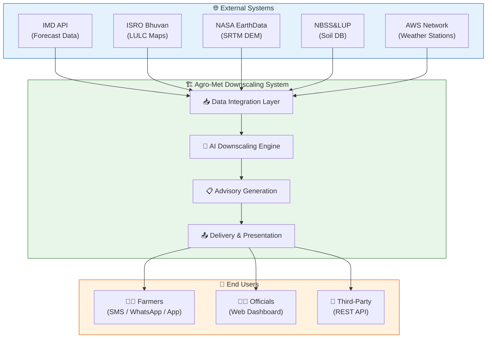
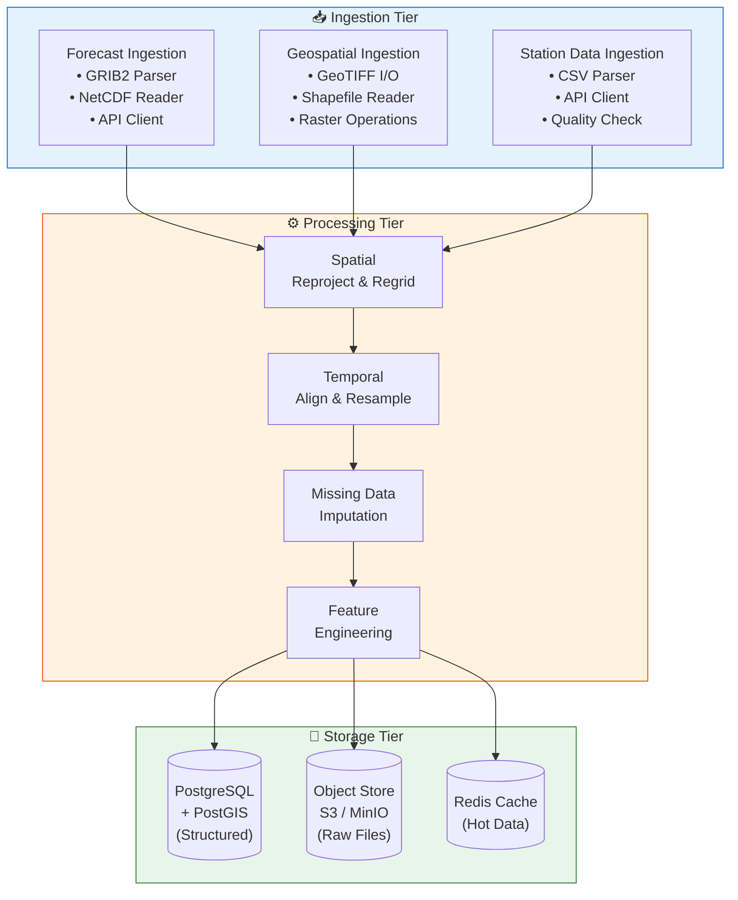
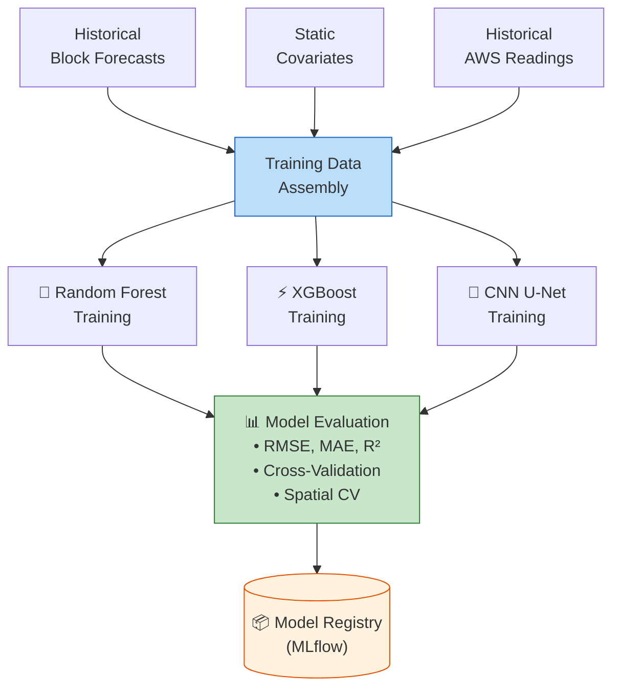
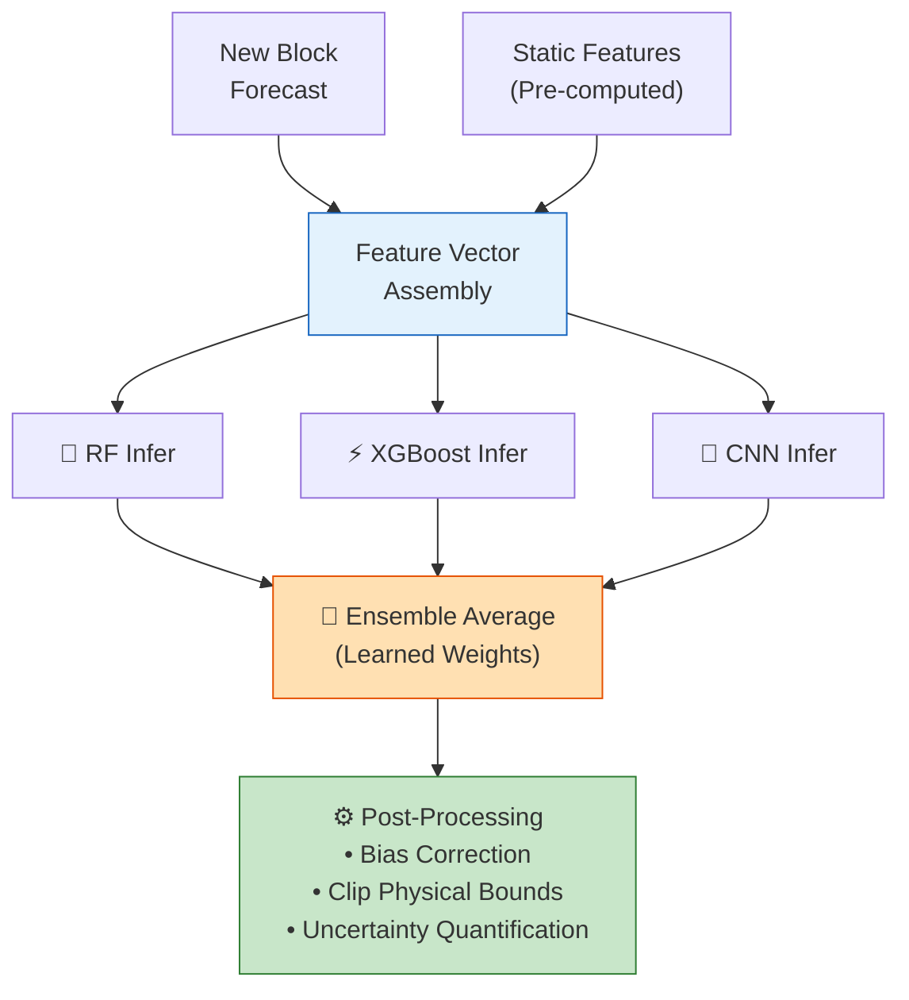
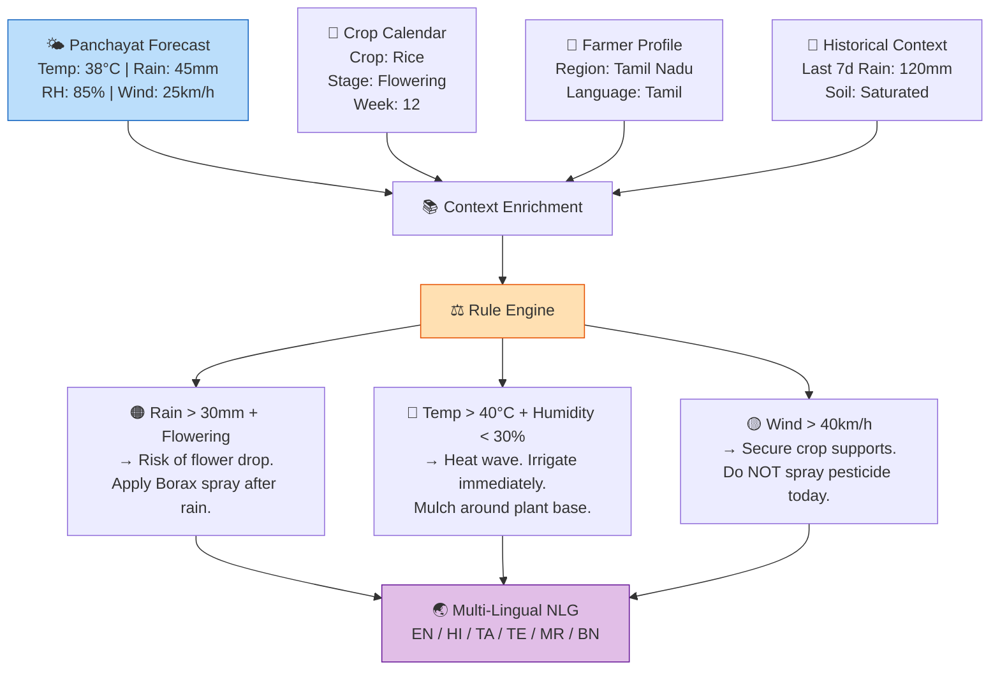
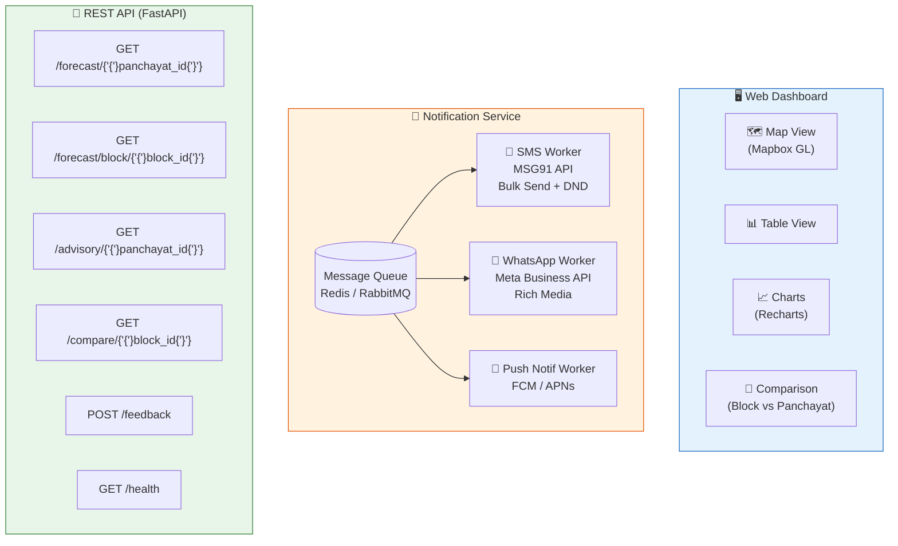
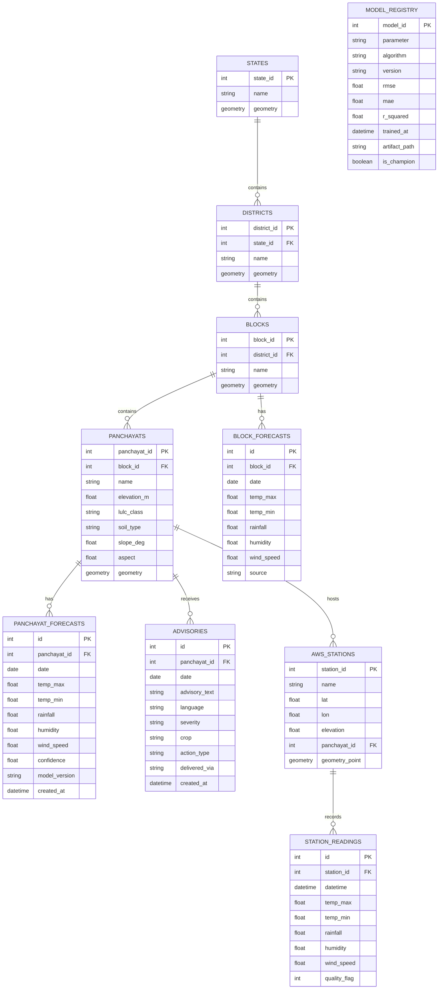

# 📐 High-Level Design (HLD)

> **Agro-Meteorological High-Resolution Downscaling System**

---

## 1. System Context Diagram

---

## 2. Module Design

### 2.1 Module 1: Data Integration Layer

**Purpose**: Ingest, validate, transform, and align all data sources into a unified format.

#### Key Decisions:
- **CRS Standard**: All spatial data reprojected to **EPSG:4326** (WGS84) for consistency
- **Grid Resolution**: Internal computation at **1 km × 1 km** grid (0.01° × 0.01°)
- **Temporal Resolution**: Daily forecasts aligned to **IST (UTC+5:30)** day boundaries
- **Missing Data**: Spatial interpolation (IDW) for elevation gaps; temporal forward-fill for station outages

---

### 2.2 Module 2: AI Downscaling Engine

**Purpose**: Apply trained ML models to predict Panchayat-level weather from block-level forecasts.

#### Training Pipeline (Offline — Weekly/Monthly)

#### Inference Pipeline (Online — Real-time)

#### Key Decisions:
- **Ensemble Strategy**: Weighted stacking with a Ridge meta-learner to combine RF, XGBoost, and CNN
- **Separate Models per Parameter**: Temperature, Rainfall, Humidity, and Wind each have dedicated models (different feature importances)
- **Spatial Cross-Validation**: Training uses Leave-One-Station-Out CV to prevent spatial autocorrelation leakage
- **Model Versioning**: MLflow tracks all experiments; champion model auto-deployed via CI/CD

---

### 2.3 Module 3: Advisory Generation

**Purpose**: Convert raw weather predictions into actionable farming advice.

---

### 2.4 Module 4: Delivery & Presentation

---

## 3. Database Design — ER Diagram

---

## 4. Technology Architecture

| Layer | Component | Technology | Justification |
|-------|-----------|-----------|---------------|
| **Compute** | ML Training | GPU instances (V100/A100) | XGBoost & CNN training require GPU acceleration |
| **Compute** | ML Inference | CPU instances (auto-scaled) | Inference is lightweight; horizontal scaling |
| **Compute** | API Server | FastAPI on Uvicorn (ASGI) | Async, high-throughput Python web framework |
| **Compute** | Task Queue | Celery + Redis | Distributed task execution for batch processing |
| **Storage** | Relational DB | PostgreSQL 15 + PostGIS 3.3 | Spatial queries, ACID compliance, mature ecosystem |
| **Storage** | Object Store | AWS S3 / MinIO | Raw data files (GRIB2, GeoTIFF) storage |
| **Storage** | Cache | Redis 7 | Hot data caching; task broker for Celery |
| **Storage** | Model Store | MLflow | Model versioning, experiment tracking |
| **Frontend** | Dashboard | React 18 + Mapbox GL JS | Interactive maps with vector tiles |
| **Frontend** | Mobile | React Native | Cross-platform mobile app |
| **Messaging** | SMS | MSG91 / Kaleyra SMPP | Bulk SMS delivery with DND compliance |
| **Messaging** | WhatsApp | Meta Business API | Rich media advisory delivery |
| **Container** | Runtime | Docker + Kubernetes | Container orchestration; auto-scaling |
| **CI/CD** | Pipeline | GitHub Actions / Jenkins | Automated testing and deployment |
| **Monitoring** | Metrics | Prometheus + Grafana | System metrics and dashboards |
| **Monitoring** | Logs | ELK Stack | Centralized logging and analysis |

---

## 5. Non-Functional Requirements

| Requirement | Target | Design Approach |
|-------------|--------|-----------------|
| **Availability** | 99.9% uptime | Multi-AZ deployment; health checks; auto-restart |
| **Latency** | < 30 min end-to-end | Pre-computed features; parallel inference |
| **Throughput** | 2.5 lakh Panchayats / forecast cycle | Batch processing with Celery workers |
| **Scalability** | Linear with Panchayat count | Stateless workers; horizontal scaling |
| **Data Freshness** | Forecasts within 30 min of IMD release | Webhook triggers; priority queue |
| **Accuracy** | RMSE < 2°C (temp), < 5mm (rain) | Ensemble models; continuous retraining |
| **Security** | Gov. of India security standards | Encryption, RBAC, audit logs |
| **Disaster Recovery** | RPO: 1 hour, RTO: 4 hours | Cross-region replicas; automated failover |

---

## 6. Integration Points

| External System | Integration Method | Frequency | Data Volume |
|----------------|-------------------|-----------|-------------|
| **IMD Forecast API** | REST API / FTP pull | 2x/day (6AM, 12PM IST) | ~50 MB/cycle |
| **NASA SRTM** | One-time download + annual update | Annual | ~100 GB (India) |
| **ISRO Bhuvan (LULC)** | API / Manual download | Annual | ~20 GB |
| **NBSS&LUP (Soil)** | Manual download | One-time | ~5 GB |
| **IMD AWS Network** | API pull | Hourly | ~10 MB/hour |
| **MSG91 (SMS)** | REST API push | Per forecast cycle | ~1 Cr messages |
| **WhatsApp Business** | REST API push | Per forecast cycle | ~50 lakh messages |
| **PMFBY Portal** | REST API push | Daily | ~1 MB/day |

---

*Document Version: 2.0 | Last Updated: September 2026*
