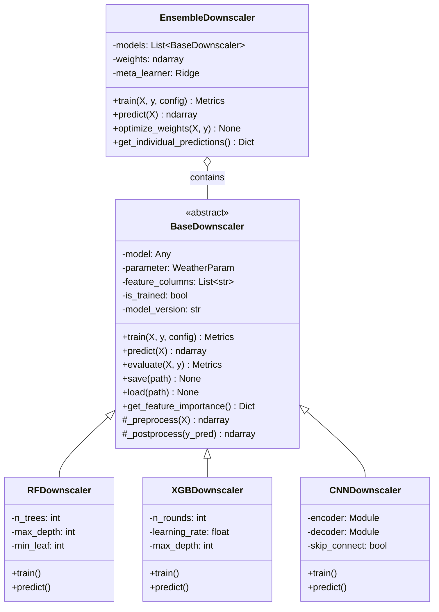
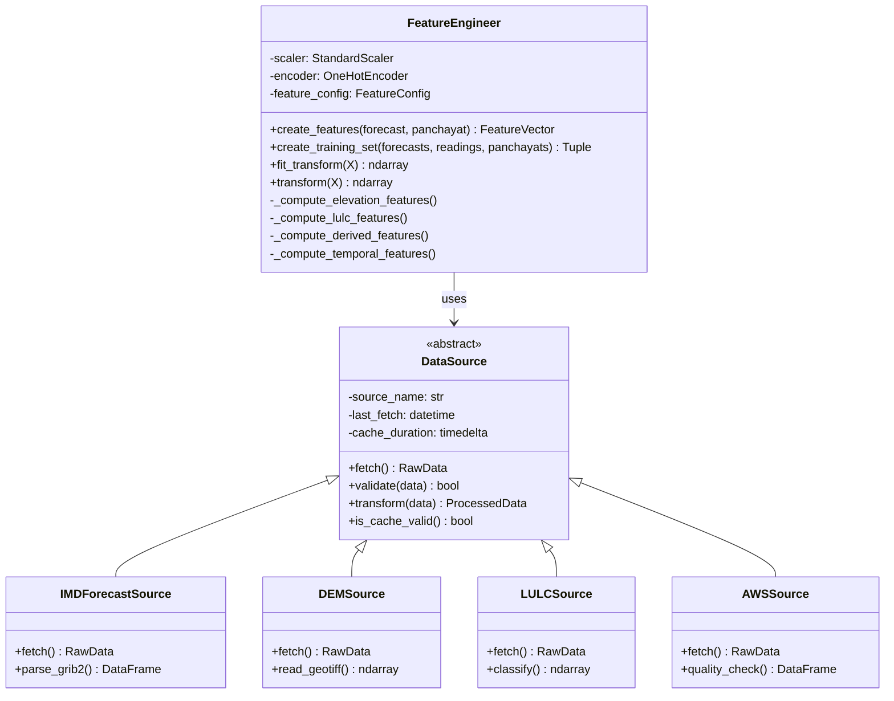
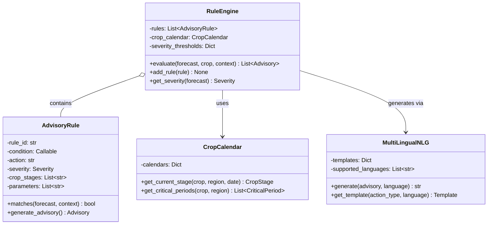
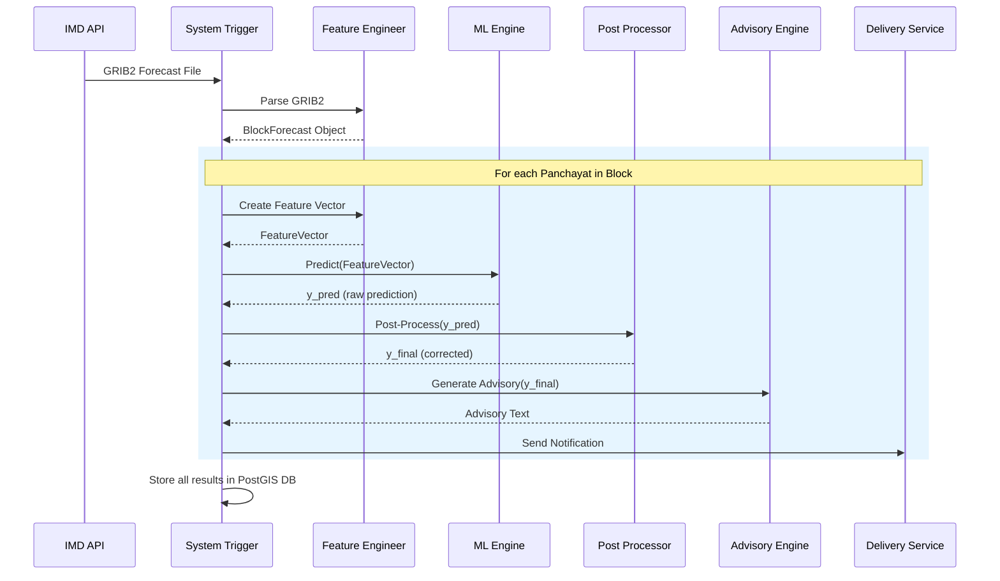

# 🔧 Low-Level Design (LLD)

> **Agro-Meteorological High-Resolution Downscaling System — Detailed Module Design**

---

## 1. Project Structure

```
agro-met-downscaling/
├── config/
│   ├── default.yaml              # Default configuration
│   ├── production.yaml           # Production overrides
│   └── model_params.yaml         # ML hyperparameters
├── src/
│   ├── __init__.py
│   ├── main.py                   # Application entry point
│   │
│   ├── ingestion/                # Module 1: Data Ingestion
│   │   ├── __init__.py
│   │   ├── forecast_fetcher.py   # IMD forecast API client
│   │   ├── dem_processor.py      # SRTM elevation processing
│   │   ├── lulc_processor.py     # Land use classification
│   │   ├── soil_processor.py     # Soil data processing
│   │   ├── aws_fetcher.py        # Weather station data
│   │   └── parsers/
│   │       ├── grib_parser.py    # GRIB2 file parser
│   │       ├── netcdf_parser.py  # NetCDF file parser
│   │       └── geotiff_reader.py # GeoTIFF reader
│   │
│   ├── preprocessing/            # Data preprocessing
│   │   ├── __init__.py
│   │   ├── spatial_alignment.py  # CRS transformation & regridding
│   │   ├── temporal_alignment.py # Time zone & period alignment
│   │   ├── quality_control.py    # Outlier detection & cleaning
│   │   ├── imputation.py         # Missing data handling
│   │   └── feature_engineering.py# Feature creation
│   │
│   ├── models/                   # Module 2: ML Models
│   │   ├── __init__.py
│   │   ├── base_model.py         # Abstract base class
│   │   ├── random_forest.py      # RF implementation
│   │   ├── xgboost_model.py      # XGBoost implementation
│   │   ├── cnn_unet.py           # CNN U-Net for spatial
│   │   ├── ensemble.py           # Ensemble combiner
│   │   ├── post_processor.py     # Bias correction & bounds
│   │   └── trainer.py            # Training orchestrator
│   │
│   ├── advisory/                 # Module 3: Advisory
│   │   ├── __init__.py
│   │   ├── rule_engine.py        # Weather → Action rules
│   │   ├── crop_calendar.py      # Crop stage lookup
│   │   ├── alert_generator.py    # Severity-based alerts
│   │   └── nlg/
│   │       ├── template_engine.py# Template-based NLG
│   │       └── translations/
│   │           ├── hi.yaml       # Hindi templates
│   │           ├── ta.yaml       # Tamil templates
│   │           ├── te.yaml       # Telugu templates
│   │           ├── mr.yaml       # Marathi templates
│   │           └── bn.yaml       # Bengali templates
│   │
│   ├── delivery/                 # Module 4: Delivery
│   │   ├── __init__.py
│   │   ├── sms_service.py        # SMS gateway integration
│   │   ├── whatsapp_service.py   # WhatsApp API integration
│   │   ├── push_notification.py  # FCM/APNs push
│   │   └── notification_queue.py # Message queue manager
│   │
│   ├── api/                      # REST API
│   │   ├── __init__.py
│   │   ├── main.py               # FastAPI app
│   │   ├── routes/
│   │   │   ├── forecast.py       # Forecast endpoints
│   │   │   ├── advisory.py       # Advisory endpoints
│   │   │   ├── stations.py       # Station data endpoints
│   │   │   ├── admin.py          # Admin endpoints
│   │   │   └── health.py         # Health check
│   │   ├── schemas/
│   │   │   ├── forecast.py       # Pydantic models
│   │   │   ├── advisory.py
│   │   │   └── common.py
│   │   ├── middleware/
│   │   │   ├── auth.py           # JWT authentication
│   │   │   ├── rate_limiter.py   # Rate limiting
│   │   │   └── logging.py        # Request logging
│   │   └── dependencies.py       # Dependency injection
│   │
│   ├── db/                       # Database
│   │   ├── __init__.py
│   │   ├── connection.py         # Database connection pool
│   │   ├── models.py             # SQLAlchemy ORM models
│   │   ├── repositories/
│   │   │   ├── panchayat_repo.py
│   │   │   ├── forecast_repo.py
│   │   │   ├── advisory_repo.py
│   │   │   └── station_repo.py
│   │   └── migrations/           # Alembic migrations
│   │       └── versions/
│   │
│   └── utils/
│       ├── __init__.py
│       ├── geo_utils.py          # Geospatial utilities
│       ├── validators.py         # Input validation
│       ├── constants.py          # System constants
│       └── logger.py             # Logging configuration
│
├── dashboard/                    # Frontend
│   ├── src/
│   │   ├── components/
│   │   │   ├── MapView.jsx       # Mapbox GL map
│   │   │   ├── ForecastTable.jsx
│   │   │   ├── WeatherChart.jsx
│   │   │   └── AdvisoryCard.jsx
│   │   ├── pages/
│   │   │   ├── Dashboard.jsx
│   │   │   ├── Compare.jsx
│   │   │   └── StationView.jsx
│   │   └── App.jsx
│   └── package.json
│
├── tests/
│   ├── unit/
│   ├── integration/
│   └── e2e/
│
├── notebooks/                    # Jupyter notebooks for EDA
├── scripts/                      # Utility scripts
├── docker/
│   ├── Dockerfile.api
│   ├── Dockerfile.worker
│   └── docker-compose.yml
├── requirements.txt
├── setup.py
└── README.md
```

---

## 2. Class Diagrams

### 2.1 Core Model Classes



### 2.2 Data Pipeline Classes



### 2.3 Advisory Classes



---

## 3. Detailed Data Structures

### 3.1 Core Enums

```python
class WeatherParam(Enum):
    TEMP_MAX = "temperature_max"
    TEMP_MIN = "temperature_min"
    RAINFALL = "rainfall"
    HUMIDITY = "relative_humidity"
    WIND_SPEED = "wind_speed"

class Severity(Enum):
    GREEN = "green"          # Normal conditions
    YELLOW = "yellow"        # Watch: Moderate weather
    ORANGE = "orange"        # Warning: Severe weather
    RED = "red"              # Alert: Extreme weather

class LULCClass(Enum):
    CROPLAND = 1
    FOREST_DENSE = 2
    FOREST_OPEN = 3
    GRASSLAND = 4
    BARREN = 5
    BUILT_UP = 6
    WATER_BODY = 7
    WETLAND = 8
    PLANTATION = 9

class SoilType(Enum):
    ALLUVIAL = "alluvial"
    BLACK_COTTON = "black_cotton"
    RED_LATERITE = "red_laterite"
    DESERT_SANDY = "desert_sandy"
    MOUNTAIN = "mountain"
    SALINE_ALKALINE = "saline_alkaline"

class CropStage(Enum):
    SOWING = "sowing"
    GERMINATION = "germination"
    VEGETATIVE = "vegetative"
    FLOWERING = "flowering"
    GRAIN_FILLING = "grain_filling"
    MATURITY = "maturity"
    HARVEST = "harvest"
```

### 3.2 Core Data Classes

```python
@dataclass
class Panchayat:
    """Represents a Panchayat with its static geographical features."""
    panchayat_id: str
    name: str
    block_id: str
    centroid_lat: float
    centroid_lon: float
    elevation_mean: float       # meters above sea level
    elevation_std: float        # terrain roughness
    slope_mean: float           # degrees
    aspect_dominant: float      # degrees (0=N, 90=E, 180=S, 270=W)
    lulc_class: LULCClass       # dominant land use
    lulc_cropland_pct: float    # % cropland
    lulc_forest_pct: float      # % forest
    lulc_urban_pct: float       # % built-up
    lulc_water_pct: float       # % water body
    soil_type: SoilType
    dist_to_water_km: float     # distance to nearest water body
    dist_to_coast_km: float     # distance to coastline
    geometry: Polygon           # boundary polygon

@dataclass
class BlockForecast:
    """Raw forecast from IMD at Block level."""
    block_id: str
    forecast_date: date
    issue_time: datetime
    lead_days: int              # 1, 2, 3, 4, 5
    temp_max: float             # °C
    temp_min: float             # °C
    rainfall: float             # mm
    humidity: float             # %
    wind_speed: float           # km/h
    wind_direction: float       # degrees
    cloud_cover: float          # oktas
    source: str                 # "IMD_GFS" / "IMD_WRF"

@dataclass
class PanchayatForecast:
    """Downscaled forecast for a specific Panchayat."""
    panchayat_id: str
    forecast_date: date
    temp_max: float
    temp_min: float
    rainfall: float
    humidity: float
    wind_speed: float
    confidence_temp: float      # 0-1
    confidence_rain: float      # 0-1
    uncertainty_lower: Dict[str, float]
    uncertainty_upper: Dict[str, float]
    model_version: str
    created_at: datetime

@dataclass
class FeatureVector:
    """Complete feature vector for ML model input."""
    # Block-level forecast features
    block_temp_max: float
    block_temp_min: float
    block_rainfall: float
    block_humidity: float
    block_wind_speed: float
    block_wind_direction: float
    block_cloud_cover: float

    # Static geographical features
    elevation: float
    elevation_anomaly: float    # diff from block mean elevation
    slope: float
    aspect_sin: float           # sin(aspect) for circular encoding
    aspect_cos: float           # cos(aspect) for circular encoding
    lulc_cropland: float
    lulc_forest: float
    lulc_urban: float
    lulc_water: float
    soil_type_encoded: List[float]  # one-hot
    dist_to_water: float
    dist_to_coast: float

    # Derived features
    temp_lapse_estimate: float  # elevation * lapse_rate
    rain_orographic_factor: float
    season: int                 # 1=Winter, 2=PreMonsoon, 3=Monsoon, 4=PostMonsoon
    day_of_year: int
    lat: float
    lon: float

@dataclass
class Advisory:
    """Actionable agricultural advisory."""
    advisory_id: str
    panchayat_id: str
    forecast_date: date
    severity: Severity
    crop: str
    crop_stage: CropStage
    action_type: str            # "irrigation", "spraying", "harvesting", etc.
    advisory_text: Dict[str, str]  # language_code → text
    weather_trigger: str        # human-readable trigger
    valid_from: datetime
    valid_until: datetime
```

---

## 4. Key Algorithm Details

### 4.1 Feature Engineering Pipeline

```python
class FeatureEngineer:
    """Creates ML-ready features from raw data."""

    TEMPERATURE_LAPSE_RATE = -6.5  # °C per 1000m (standard atmosphere)

    def create_features(self, forecast: BlockForecast, panchayat: Panchayat) -> FeatureVector:
        """
        Algorithm:
        1. Start with raw block forecast values
        2. Add static geographical features from Panchayat
        3. Compute derived features:
           a. Elevation anomaly = panchayat_elev - block_mean_elev
           b. Temperature lapse estimate = anomaly * LAPSE_RATE / 1000
           c. Orographic rainfall factor based on slope + aspect + wind direction
           d. Circular encoding of aspect (sin, cos)
           e. Season from date
        4. One-hot encode categorical features (soil_type, lulc)
        5. Scale numerical features (StandardScaler, fit on training data)
        """

        # Step 1: Direct forecast features
        features = {
            'block_temp_max': forecast.temp_max,
            'block_temp_min': forecast.temp_min,
            'block_rainfall': forecast.rainfall,
            'block_humidity': forecast.humidity,
            'block_wind_speed': forecast.wind_speed,
        }

        # Step 2: Static features
        features['elevation'] = panchayat.elevation_mean
        features['slope'] = panchayat.slope_mean
        features['dist_to_water'] = panchayat.dist_to_water_km

        # Step 3: Derived features
        block_mean_elev = self._get_block_mean_elevation(forecast.block_id)
        features['elevation_anomaly'] = panchayat.elevation_mean - block_mean_elev
        features['temp_lapse_estimate'] = (
            features['elevation_anomaly'] * self.TEMPERATURE_LAPSE_RATE / 1000
        )

        # Orographic rainfall enhancement
        wind_dir_rad = np.radians(forecast.wind_direction)
        aspect_rad = np.radians(panchayat.aspect_dominant)
        # Rainfall enhancement when wind hits upslope
        features['rain_orographic_factor'] = (
            panchayat.slope_mean *
            max(0, np.cos(wind_dir_rad - aspect_rad))
        )

        # Circular encoding of aspect
        features['aspect_sin'] = np.sin(aspect_rad)
        features['aspect_cos'] = np.cos(aspect_rad)

        # Temporal features
        features['season'] = self._get_season(forecast.forecast_date)
        features['day_of_year'] = forecast.forecast_date.timetuple().tm_yday

        return FeatureVector(**features)
```

### 4.2 Ensemble Prediction Algorithm

```python
class EnsembleDownscaler:
    """
    Combines predictions from multiple models using learned weights.

    Stacking approach:
    1. Each base model predicts independently
    2. Base model predictions become features for a meta-learner
    3. Meta-learner (Ridge regression) produces final prediction
    4. Post-processing ensures physical consistency
    """

    def predict(self, X: np.ndarray) -> np.ndarray:
        # Step 1: Get predictions from each base model
        base_predictions = {}
        for model in self.models:
            base_predictions[model.name] = model.predict(X)

        # Step 2: Stack predictions as meta-features
        meta_features = np.column_stack(list(base_predictions.values()))

        # Step 3: Meta-learner combines predictions
        y_pred = self.meta_learner.predict(meta_features)

        # Step 4: Post-processing
        y_pred = self._apply_bias_correction(y_pred, X)
        y_pred = self._clip_to_physical_bounds(y_pred)
        y_pred = self._spatial_smoothing(y_pred, X)

        return y_pred

    def _clip_to_physical_bounds(self, y_pred, parameter):
        """Ensure predictions are physically realistic."""
        bounds = {
            'temp_max': (-10, 55),     # °C (Indian range)
            'temp_min': (-15, 40),
            'rainfall': (0, 500),       # mm/day
            'humidity': (0, 100),       # %
            'wind_speed': (0, 200),     # km/h
        }
        lo, hi = bounds[parameter]
        return np.clip(y_pred, lo, hi)
```

### 4.3 Advisory Rule Engine Logic

```python
class RuleEngine:
    """
    Evaluates weather conditions against crop-specific rules
    to generate actionable advisories.
    """

    def evaluate(self, forecast, crop, context):
        advisories = []

        # Rule 1: Heavy Rain Alert
        if forecast.rainfall > 30:
            if context.crop_stage in [CropStage.FLOWERING, CropStage.GRAIN_FILLING]:
                advisories.append(Advisory(
                    severity=Severity.ORANGE,
                    action_type="harvesting",
                    advisory_text="Heavy rain ({rain}mm) during {stage}. "
                                  "Risk of crop damage. Ensure drainage."
                ))

        # Rule 2: Heat Wave
        if forecast.temp_max > 42 and forecast.humidity < 30:
            advisories.append(Advisory(
                severity=Severity.RED,
                action_type="irrigation",
                advisory_text="Heat wave ({temp}°C). Irrigate immediately. "
                              "Apply mulch. Avoid field work 11AM-3PM."
            ))

        # Rule 3: Frost Risk
        if forecast.temp_min < 4:
            advisories.append(Advisory(
                severity=Severity.RED,
                action_type="protection",
                advisory_text="Frost expected ({temp}°C). Cover nursery beds. "
                              "Light irrigation before midnight reduces frost damage."
            ))

        # Rule 4: Spray Window
        if (forecast.wind_speed < 15 and
            forecast.rainfall < 5 and
            6 <= forecast.humidity <= 80):
            advisories.append(Advisory(
                severity=Severity.GREEN,
                action_type="spraying",
                advisory_text="Good conditions for spraying. "
                              "Wind < 15km/h, no rain expected."
            ))

        return advisories
```

---

## 5. API Endpoint Design

### 5.1 Forecast Endpoints

```
GET /api/v1/forecast/{panchayat_id}
├── Query Params:
│   ├── date: str (YYYY-MM-DD, default=today)
│   ├── days: int (1-5, default=3)
│   └── include_uncertainty: bool (default=false)
├── Response: 200 OK
│   {
│     "panchayat_id": "MH_PUNE_MULSHI_TAMHINI",
│     "panchayat_name": "Tamhini",
│     "block_name": "Mulshi",
│     "district": "Pune",
│     "state": "Maharashtra",
│     "forecasts": [
│       {
│         "date": "2026-09-26",
│         "temp_max": 27.3,
│         "temp_min": 21.8,
│         "rainfall": 22.5,
│         "humidity": 85.2,
│         "wind_speed": 12.4,
│         "confidence": 0.87,
│         "uncertainty": {
│           "temp_max": [25.8, 28.9],
│           "rainfall": [15.0, 35.0]
│         },
│         "block_forecast": {
│           "temp_max": 32.0,
│           "rainfall": 15.0
│         }
│       }
│     ],
│     "model_version": "v2.3.1",
│     "generated_at": "2026-09-25T06:30:00+05:30"
│   }
├── Error Responses:
│   ├── 404: Panchayat not found
│   ├── 422: Invalid date format
│   └── 503: Model not available
```

### 5.2 Advisory Endpoints

```
GET /api/v1/advisory/{panchayat_id}
├── Query Params:
│   ├── crop: str (rice/wheat/cotton/etc.)
│   ├── language: str (hi/en/ta/te/mr/bn, default=en)
│   └── date: str (YYYY-MM-DD, default=today)
├── Response: 200 OK
│   {
│     "panchayat_id": "MH_PUNE_MULSHI_TAMHINI",
│     "date": "2026-09-26",
│     "crop": "rice",
│     "crop_stage": "flowering",
│     "advisories": [
│       {
│         "severity": "orange",
│         "action_type": "harvesting",
│         "message": "Heavy rain (22mm) expected during flowering stage. "
│                    "Risk of flower drop. Ensure field drainage. "
│                    "Apply Borax spray after rain stops.",
│         "valid_until": "2026-09-27T18:00:00+05:30"
│       },
│       {
│         "severity": "green",
│         "action_type": "irrigation",
│         "message": "Sufficient rainfall expected. "
│                    "No irrigation needed for next 2 days.",
│         "valid_until": "2026-09-28T06:00:00+05:30"
│       }
│     ],
│     "language": "en"
│   }
```

### 5.3 Comparison Endpoints

```
GET /api/v1/compare/{block_id}
├── Query Params:
│   ├── date: str (YYYY-MM-DD)
│   └── parameter: str (temp_max/rainfall/humidity/wind_speed)
├── Response: 200 OK
│   {
│     "block_id": "MH_PUNE_MULSHI",
│     "block_forecast": {
│       "temp_max": 32.0,
│       "rainfall": 15.0
│     },
│     "panchayat_forecasts": [
│       {
│         "panchayat_id": "MH_PUNE_MULSHI_TAMHINI",
│         "name": "Tamhini Ghat",
│         "temp_max": 27.3,
│         "rainfall": 22.5,
│         "elevation": 650
│       },
│       {
│         "panchayat_id": "MH_PUNE_MULSHI_PAUD",
│         "name": "Paud",
│         "temp_max": 31.2,
│         "rainfall": 14.8,
│         "elevation": 580
│       }
│     ],
│     "statistics": {
│       "temp_max_range": [27.3, 34.1],
│       "rainfall_range": [8.0, 22.5],
│       "max_deviation_from_block": 6.8
│     }
│   }
```

---

## 6. Error Handling Strategy

```python
class DownscalingError(Exception):
    """Base exception for all downscaling errors."""
    pass

class DataIngestionError(DownscalingError):
    """Raised when data source is unavailable or corrupt."""
    def __init__(self, source: str, message: str):
        self.source = source
        super().__init__(f"Data ingestion failed for {source}: {message}")

class ModelInferenceError(DownscalingError):
    """Raised when model prediction fails."""
    def __init__(self, model_name: str, parameter: str):
        super().__init__(f"Inference failed: {model_name} for {parameter}")

class AdvisoryGenerationError(DownscalingError):
    """Raised when advisory generation fails."""
    pass

# Fallback Strategy
class FallbackHandler:
    """
    When the downscaling pipeline fails, gracefully degrade:
    1. Try ensemble → Try individual model → Try climatology
    2. If advisory fails → Send raw forecast without advice
    3. If SMS fails → Queue for retry → Log for manual intervention
    """

    def get_forecast_with_fallback(self, panchayat_id, date):
        try:
            return self.ensemble_model.predict(...)
        except ModelInferenceError:
            logger.warning("Ensemble failed, trying XGBoost only")
            try:
                return self.xgboost_model.predict(...)
            except ModelInferenceError:
                logger.error("All models failed, using climatology")
                return self.climatology_lookup(panchayat_id, date)
```

---

## 7. Sequence Diagrams

### 7.1 Real-Time Forecast Generation



---

*Document Version: 1.0 | Last Updated: September 2026*
