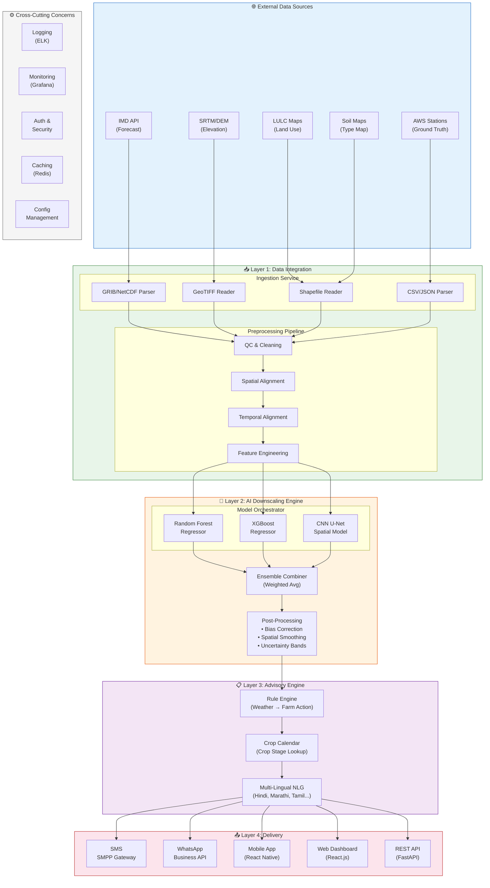
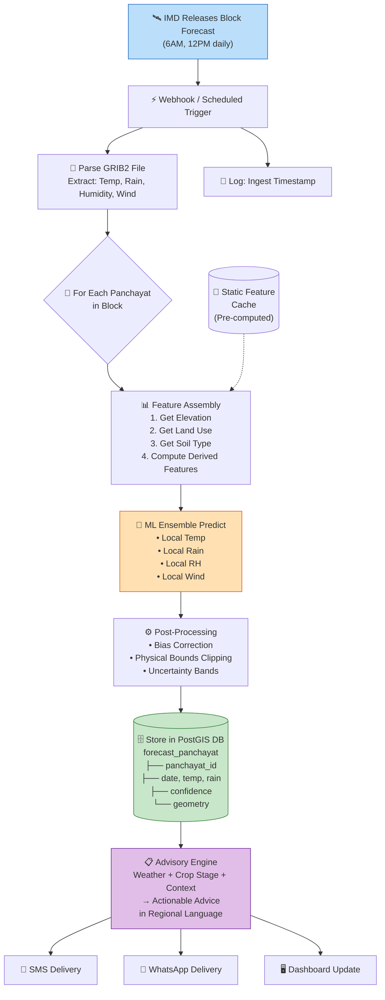
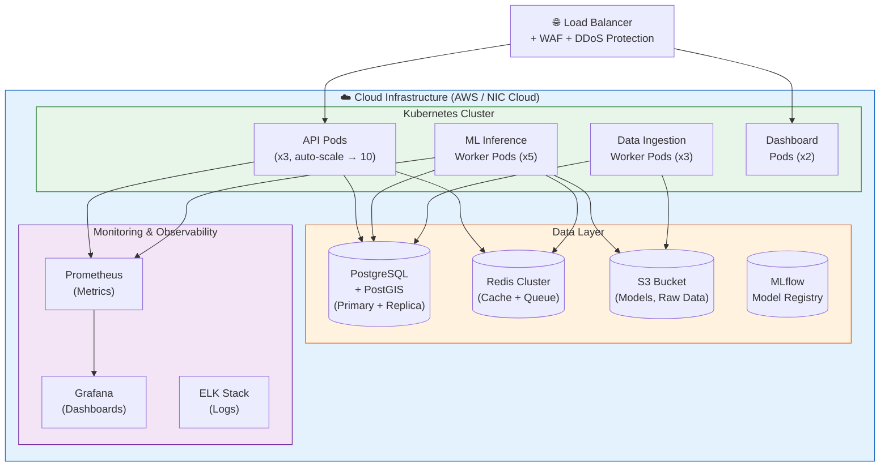
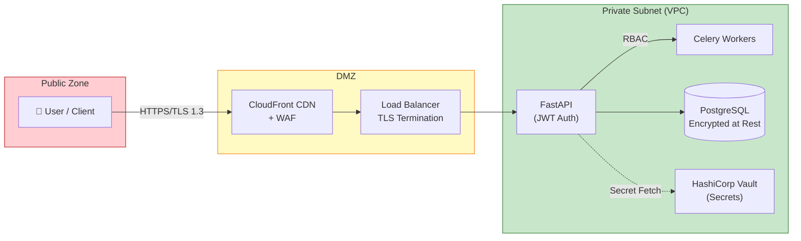

# 🏗️ System Architecture

> **Agro-Meteorological High-Resolution Downscaling System — Architecture Overview**

---

## 1. Architecture Overview

The system follows a **modular, microservices-based architecture** with four primary layers:

1. **Data Integration Layer** — Ingests and preprocesses all input data
2. **AI Downscaling Engine** — Core ML inference pipeline
3. **Advisory Generation Layer** — Converts predictions to actionable advice
4. **Delivery & Presentation Layer** — User-facing interfaces

---

## 2. Component Details

### 2.1 Layer 1: Data Integration

| Component | Responsibility | Input | Output |
|-----------|---------------|-------|--------|
| **IMD Forecast Fetcher** | Pull latest block-level forecasts via API/FTP | GRIB2/NetCDF files | Structured forecast DataFrame |
| **DEM Processor** | Extract elevation, slope, aspect for each grid point | SRTM GeoTIFF (30m) | Elevation features per Panchayat |
| **LULC Processor** | Classify land use categories per grid point | ISRO LULC maps | One-hot encoded land features |
| **Soil Data Processor** | Extract soil type, depth, texture | NBSS&LUP soil maps | Soil feature vectors |
| **AWS Data Fetcher** | Pull historical & real-time station data | IMD AWS network CSV | Ground truth training data |
| **Feature Engineer** | Combine all features into ML-ready matrix | All above | Feature matrix (X) + Target (y) |

### 2.2 Layer 2: AI Downscaling Engine

| Component | Responsibility | Algorithm | When Used |
|-----------|---------------|-----------|-----------| 
| **Random Forest** | Primary regression model; robust to noise | Ensemble of 500 decision trees | Temperature, Humidity |
| **XGBoost** | Gradient boosting for high accuracy | 200 boosting rounds, depth=8 | Rainfall, Wind Speed |
| **CNN (U-Net)** | Spatial pattern learning from gridded data | Modified U-Net with skip connections | Spatial interpolation |
| **Ensemble Combiner** | Weighted average of all models | Stacking with Ridge meta-learner | Final prediction |
| **Post-Processor** | Bias correction, physical consistency checks | Quantile mapping + physics constraints | All parameters |

### 2.3 Layer 3: Advisory Generation

| Component | Responsibility | Example |
|-----------|---------------|---------|
| **Rule Engine** | Maps weather conditions to farming actions | Rain > 30mm → "Postpone harvesting" |
| **Crop Calendar** | Knows what growth stage each crop is in | Rice in Kharif, Week 12 → "Flowering stage" |
| **Alert Generator** | Creates severity-based alerts | Temp > 42°C → "Heat wave alert: Protect nursery" |
| **NLG Module** | Generates natural language in regional scripts | Hindi: "कल भारी बारिश की संभावना, कटाई स्थगित करें" |

### 2.4 Layer 4: Delivery

| Channel | Technology | Target Users | Latency |
|---------|-----------|-------------|---------|
| **SMS** | SMPP Gateway (MSG91/Kaleyra) | Feature phone users | < 5 min |
| **WhatsApp** | WhatsApp Business API | Smartphone users | < 2 min |
| **Mobile App** | React Native | Tech-savvy farmers, extension workers | Real-time |
| **Web Dashboard** | React.js + Mapbox GL | Officials, researchers, media | Real-time |
| **REST API** | FastAPI | Third-party integrations | < 100ms |

---

## 3. Data Flow

---

## 4. Infrastructure Architecture

---

## 5. Security Architecture

| Layer | Security Measure | Implementation |
|-------|-----------------|----------------|
| **Network** | VPC with private subnets | All services in private subnet; only API & Dashboard public |
| **Authentication** | JWT + OAuth2 | API keys for M2M; SSO for dashboard |
| **Authorization** | RBAC | Roles: Admin, Operator, Viewer, API Consumer |
| **Data** | Encryption at rest + transit | AES-256 at rest; TLS 1.3 in transit |
| **API** | Rate limiting + API keys | 1000 req/min per key; DDOS protection via CDN |
| **Secrets** | Vault/KMS | No secrets in code; rotated every 90 days |
| **Audit** | Comprehensive logging | All access logged with user, timestamp, action |

---

## 6. Scalability & Performance

| Metric | Requirement | Design Decision |
|--------|------------|-----------------|
| **Panchayats Served** | 2.5 lakh+ | Horizontal scaling of worker pods |
| **Forecast Latency** | < 30 min from IMD release | Pre-computed static features; parallel inference |
| **API Response Time** | < 100ms (p99) | Redis caching; pre-computed results |
| **SMS Delivery** | 1 Crore+ messages/day | Distributed SMS gateway; bulk API |
| **Data Storage** | 5+ years of forecasts | Partitioned PostgreSQL; cold storage on S3 |
| **Model Retraining** | Weekly | Automated pipeline with MLflow |
| **Concurrent Users** | 10,000+ dashboard users | CDN + load-balanced React app |

---

*Document Version: 2.0 | Last Updated: September 2026*
