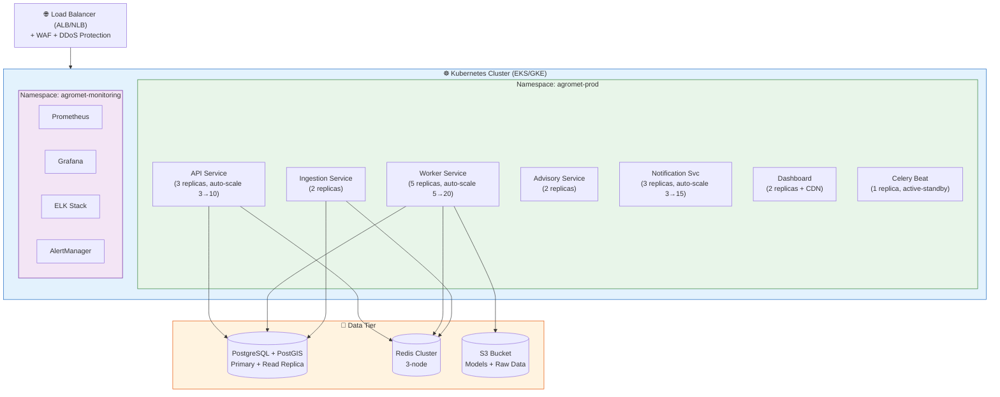

# 🚀 Deployment Guide

> **Infrastructure, Deployment Strategy, and Production Operations**

---

## 1. Deployment Architecture



---

## 2. Docker Configuration

### 2.1 API Dockerfile

```dockerfile
# docker/Dockerfile.api
FROM python:3.10-slim

WORKDIR /app

# Install system dependencies (GDAL, etc.)
RUN apt-get update && apt-get install -y \
    gdal-bin libgdal-dev libgeos-dev libproj-dev \
    && rm -rf /var/lib/apt/lists/*

# Install Python dependencies
COPY requirements.txt .
RUN pip install --no-cache-dir -r requirements.txt

# Copy application code
COPY src/ ./src/
COPY config/ ./config/

# Health check
HEALTHCHECK --interval=30s --timeout=5s --retries=3 \
  CMD curl -f http://localhost:8000/api/v1/health || exit 1

# Run
EXPOSE 8000
CMD ["uvicorn", "src.api.main:app", "--host", "0.0.0.0", "--port", "8000", "--workers", "4"]
```

### 2.2 Worker Dockerfile

```dockerfile
# docker/Dockerfile.worker
FROM python:3.10-slim

WORKDIR /app

RUN apt-get update && apt-get install -y \
    gdal-bin libgdal-dev libgeos-dev libproj-dev \
    && rm -rf /var/lib/apt/lists/*

COPY requirements.txt .
RUN pip install --no-cache-dir -r requirements.txt

COPY src/ ./src/
COPY config/ ./config/

CMD ["celery", "-A", "src.worker.app", "worker", "--loglevel=info", "--concurrency=4"]
```

### 2.3 Docker Compose (Development)

```yaml
# docker/docker-compose.yml
version: '3.8'

services:
  api:
    build:
      context: ..
      dockerfile: docker/Dockerfile.api
    ports:
      - "8000:8000"
    environment:
      - DATABASE_URL=postgresql://agromet:password@db:5432/agromet
      - REDIS_URL=redis://redis:6379/0
    depends_on:
      - db
      - redis
    volumes:
      - ../src:/app/src  # Hot reload in dev

  worker:
    build:
      context: ..
      dockerfile: docker/Dockerfile.worker
    environment:
      - DATABASE_URL=postgresql://agromet:password@db:5432/agromet
      - REDIS_URL=redis://redis:6379/0
    depends_on:
      - db
      - redis

  db:
    image: postgis/postgis:15-3.3
    environment:
      POSTGRES_DB: agromet
      POSTGRES_USER: agromet
      POSTGRES_PASSWORD: password
    ports:
      - "5432:5432"
    volumes:
      - pgdata:/var/lib/postgresql/data

  redis:
    image: redis:7-alpine
    ports:
      - "6379:6379"

  dashboard:
    build:
      context: ../dashboard
    ports:
      - "3000:3000"
    depends_on:
      - api

volumes:
  pgdata:
```

---

## 3. Kubernetes Manifests

### 3.1 API Deployment

```yaml
# k8s/api-deployment.yaml
apiVersion: apps/v1
kind: Deployment
metadata:
  name: agromet-api
  namespace: agromet-prod
spec:
  replicas: 3
  selector:
    matchLabels:
      app: agromet-api
  template:
    metadata:
      labels:
        app: agromet-api
    spec:
      containers:
        - name: api
          image: registry.agromet.gov.in/agromet-api:v1.2.0
          ports:
            - containerPort: 8000
          resources:
            requests:
              cpu: "500m"
              memory: "1Gi"
            limits:
              cpu: "2000m"
              memory: "4Gi"
          envFrom:
            - secretRef:
                name: agromet-secrets
          readinessProbe:
            httpGet:
              path: /api/v1/health
              port: 8000
            initialDelaySeconds: 10
            periodSeconds: 5
          livenessProbe:
            httpGet:
              path: /api/v1/health
              port: 8000
            initialDelaySeconds: 30
            periodSeconds: 10
---
apiVersion: autoscaling/v2
kind: HorizontalPodAutoscaler
metadata:
  name: agromet-api-hpa
spec:
  scaleTargetRef:
    apiVersion: apps/v1
    kind: Deployment
    name: agromet-api
  minReplicas: 3
  maxReplicas: 10
  metrics:
    - type: Resource
      resource:
        name: cpu
        target:
          type: Utilization
          averageUtilization: 70
```

---

## 4. CI/CD Pipeline

```mermaid
graph LR
    PUSH["💻 Code Push<br/>(Git)"] --> BUILD["🔨 Build & Lint"]
    BUILD --> TEST["🧪 Test Suite"]
    TEST --> STAGE["🚀 Deploy<br/>(Staging)"]
    STAGE --> INT["🔗 Integration<br/>Tests"]
    INT --> APPROVE["✅ Manual Approval<br/>(for Production)"]
    APPROVE --> PROD["🌐 Deploy (Production)<br/>Rolling Update"]

    style PUSH fill:#e3f2fd,stroke:#1565c0
    style BUILD fill:#fff3e0,stroke:#e65100
    style TEST fill:#e8f5e9,stroke:#2e7d32
    style STAGE fill:#f3e5f5,stroke:#6a1b9a
    style INT fill:#e8f5e9,stroke:#2e7d32
    style APPROVE fill:#fff9c4,stroke:#f57f17
    style PROD fill:#c8e6c9,stroke:#2e7d32
```



### GitHub Actions Workflow

```yaml
# .github/workflows/deploy.yml
name: Build & Deploy

on:
  push:
    branches: [main]
  pull_request:
    branches: [main]

jobs:
  test:
    runs-on: ubuntu-latest
    steps:
      - uses: actions/checkout@v4
      - uses: actions/setup-python@v4
        with:
          python-version: '3.10'
      - run: pip install -r requirements.txt
      - run: python -m pytest tests/ --cov=src --cov-report=xml
      - run: ruff check src/
      - run: mypy src/

  build:
    needs: test
    runs-on: ubuntu-latest
    steps:
      - uses: actions/checkout@v4
      - name: Build Docker image
        run: docker build -t agromet-api:${{ github.sha }} -f docker/Dockerfile.api .
      - name: Push to registry
        run: |
          docker tag agromet-api:${{ github.sha }} registry.agromet.gov.in/agromet-api:${{ github.sha }}
          docker push registry.agromet.gov.in/agromet-api:${{ github.sha }}

  deploy-staging:
    needs: build
    runs-on: ubuntu-latest
    environment: staging
    steps:
      - name: Deploy to staging
        run: |
          kubectl set image deployment/agromet-api \
            api=registry.agromet.gov.in/agromet-api:${{ github.sha }} \
            -n agromet-staging

  deploy-production:
    needs: deploy-staging
    runs-on: ubuntu-latest
    environment: production
    steps:
      - name: Deploy to production (rolling)
        run: |
          kubectl set image deployment/agromet-api \
            api=registry.agromet.gov.in/agromet-api:${{ github.sha }} \
            -n agromet-prod
```

---

## 5. Environment Configuration

| Variable | Staging | Production | Description |
|----------|---------|------------|-------------|
| `DATABASE_URL` | postgres://...staging-db | postgres://...prod-db | PostgreSQL connection |
| `REDIS_URL` | redis://staging-redis:6379 | redis://prod-redis-cluster:6379 | Redis connection |
| `IMD_API_KEY` | test key | production key | IMD forecast API |
| `SMS_API_KEY` | sandbox | production | MSG91 gateway |
| `MODEL_BUCKET` | s3://agromet-staging/models | s3://agromet-prod/models | ML model storage |
| `LOG_LEVEL` | DEBUG | INFO | Application logging |
| `SENTRY_DSN` | staging DSN | production DSN | Error tracking |

---

## 6. Monitoring & Alerts

| Alert | Condition | Severity | Action |
|-------|-----------|----------|--------|
| **API Down** | Health check fails for > 2 min | Critical | Page on-call engineer |
| **High Latency** | p99 > 500ms for 5 min | Warning | Scale up API pods |
| **Forecast Stale** | No new forecast for > 2 hours | Critical | Check IMD data pipeline |
| **Model Drift** | RMSE increases > 10% from baseline | Warning | Trigger model retraining |
| **DB Storage** | Disk > 80% | Warning | Archive old data; expand storage |
| **SMS Failure** | Delivery rate < 90% | Warning | Check SMS gateway; switch backup |
| **Memory Leak** | Pod memory > 3.5 GB | Warning | Restart pod; investigate |

---

## 7. Disaster Recovery

| Scenario | RPO | RTO | Strategy |
|----------|-----|-----|----------|
| **Database failure** | 1 hour | 4 hours | Automated failover to read replica; WAL restore |
| **AZ failure** | 0 | 15 min | Multi-AZ deployment; auto DNS failover |
| **Region failure** | 1 hour | 2 hours | Cross-region replica; Route53 health checks |
| **Data corruption** | 1 hour | 4 hours | Point-in-time recovery from WAL backup |
| **ML model corruption** | 0 | 5 min | Rollback to previous model version in MLflow |

---

## 8. Phased Deployment Plan

| Phase | Scope | Timeline | Details |
|-------|-------|----------|---------|
| **Phase 0** | Development environment | Month 1-2 | Docker Compose; local development |
| **Phase 1** | Pilot (1 district) | Month 3-4 | 1 district, ~50 Panchayats; staging cluster |
| **Phase 2** | State rollout | Month 5-8 | Maharashtra (all districts); production cluster |
| **Phase 3** | Multi-state | Month 9-14 | 5 priority states; auto-scaled infrastructure |
| **Phase 4** | National | Month 15-18 | All India; multi-region deployment |

---

*Document Version: 1.0 | Last Updated: September 2026*
