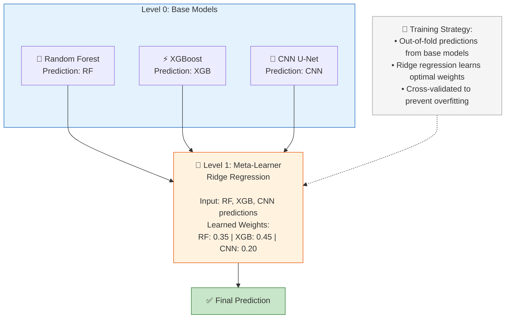
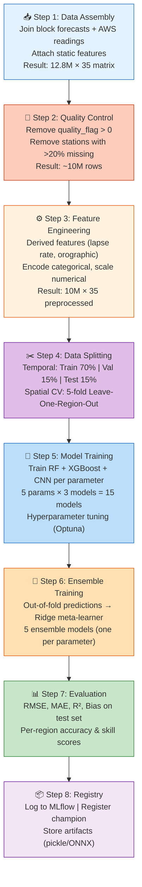

# 🧠 Methodology

> **ML Approach, Algorithms, Training Pipeline, and Evaluation Strategy**

---

## 1. Methodology Overview

The system uses **Statistical Downscaling with Machine Learning** — a technique borrowed from climate science where low-resolution climate model outputs are enhanced to high-resolution local predictions using learned relationships with geographical covariates.


---

## 2. Why Statistical Downscaling?

### 2.1 Approaches Comparison

| Approach | Description | Pros | Cons | Our Choice |
|----------|-------------|------|------|------------|
| **Dynamic Downscaling** | Run high-res NWP (WRF) model | Physics-based; spatially consistent | Extremely expensive (HPC); slow (hours); needs expertise | ❌ |
| **Simple Interpolation** | Spatial interpolation (IDW/Kriging) | Simple; fast | Doesn't account for terrain; smooths extremes | ❌ |
| **Statistical Downscaling** | ML model with covariates | Fast; accounts for local features; scalable; affordable | Needs training data; assumes stationarity | ✅ |
| **Deep Learning (Super-Resolution)** | CNN/GAN on gridded data | Captures spatial patterns; state-of-the-art | Needs large datasets; black-box; GPU-intensive | ✅ (Part of ensemble) |

### 2.2 Our Hybrid Approach

We combine **traditional ML** (Random Forest, XGBoost) for tabular feature-based prediction with **CNN** for spatial pattern learning, using an **ensemble** to leverage the strengths of each.

---

## 3. Algorithm Details

### 3.1 Random Forest Regressor

**Why**: Robust to noise, handles non-linear relationships, minimal hyperparameter tuning, naturally handles mixed feature types.

```
Random Forest for Temperature Downscaling
==========================================

Input Features (35):
├── Block forecast: temp_max=32°C, rain=15mm, humidity=78%...
├── Elevation: mean=650m, std=120m, anomaly=+150m
├── Land Use: forest=60%, crop=25%, urban=5%
├── Soil: Black Cotton, clay texture
└── Derived: lapse_estimate=-0.98°C, season=Monsoon

Architecture:
┌──────────────────────────────────────┐
│ Forest of 500 Decision Trees         │
│                                      │
│ Tree 1: Splits on elevation_anomaly  │
│   → Split on block_temp_max          │
│     → Split on forest_pct            │
│       → Prediction: 27.1°C           │
│                                      │
│ Tree 2: Splits on season             │
│   → Split on elevation               │
│     → Split on lulc_dominant          │
│       → Prediction: 27.5°C           │
│                                      │
│ ... (498 more trees)                 │
│                                      │
│ Final: Average of 500 predictions    │
│ Result: 27.3°C (±1.2°C)             │
└──────────────────────────────────────┘

Hyperparameters:
├── n_estimators: 500
├── max_depth: 20
├── min_samples_leaf: 10
├── max_features: 'sqrt'
├── bootstrap: True
└── n_jobs: -1 (all cores)
```

### 3.2 XGBoost Regressor

**Why**: Superior accuracy for tabular data; handles missing values natively; regularization prevents overfitting; GPU support for training.

```
XGBoost for Rainfall Downscaling
=================================

Key advantage for rainfall:
- Rainfall has a zero-inflated distribution (many 0mm days)
- XGBoost handles this better than RF with its loss function

Architecture:
┌──────────────────────────────────────┐
│ Gradient Boosted Trees (200 rounds)  │
│                                      │
│ Round 1: Weak learner predicts mean  │
│   → Residual = actual - predicted    │
│                                      │
│ Round 2: New tree fits residual      │
│   → Focus on errors from Round 1    │
│                                      │
│ Round 3: Another tree on residuals   │
│   → Shrunk by learning rate (0.05)  │
│                                      │
│ ... (197 more rounds)               │
│                                      │
│ Final: Sum of all tree predictions   │
│ Result: 22.5mm (±4.8mm)             │
└──────────────────────────────────────┘

Hyperparameters:
├── n_estimators: 200
├── max_depth: 8
├── learning_rate: 0.05
├── subsample: 0.8
├── colsample_bytree: 0.8
├── min_child_weight: 5
├── reg_alpha: 0.1 (L1)
├── reg_lambda: 1.0 (L2)
├── objective: 'reg:squarederror'
└── tree_method: 'gpu_hist' (if GPU)
```

### 3.3 CNN U-Net (Spatial Model)

**Why**: Captures spatial autocorrelation; learns rainfall patterns from 2D gridded data; good for spatially coherent outputs.

```
CNN U-Net Architecture for Spatial Downscaling
===============================================

Input: 2D grid of block-level weather + elevation
       (25km resolution → 1km resolution)

       Input (25×25 grid)
            │
     ┌──────▼──────┐
     │  Conv2D 64  │   Encoder
     │  Conv2D 64  │   (Downsample)
     │  MaxPool    │
     ├─────────────┤
     │  Conv2D 128 │
     │  Conv2D 128 │
     │  MaxPool    │
     ├─────────────┤
     │  Conv2D 256 │   Bottleneck
     │  Conv2D 256 │
     ├─────────────┤
     │  UpConv 128 │   Decoder
     │  + Skip Conn│   (Upsample)
     │  Conv2D 128 │
     ├─────────────┤
     │  UpConv 64  │
     │  + Skip Conn│
     │  Conv2D 64  │
     ├─────────────┤
     │  Conv2D 1   │   Output
     └──────┬──────┘
            │
     Output (25×25 → 1km residuals)

The CNN predicts the RESIDUAL (difference from spatial
interpolation), not the absolute value. This makes
learning easier and more stable.
```

### 3.4 Ensemble Strategy: Stacking



---

## 4. Training Pipeline

### 4.1 Complete Training Flow



### 4.2 Hyperparameter Optimization

```python
# Optuna-based hyperparameter search
import optuna

def objective(trial):
    params = {
        'n_estimators': trial.suggest_int('n_estimators', 100, 500),
        'max_depth': trial.suggest_int('max_depth', 4, 15),
        'learning_rate': trial.suggest_float('learning_rate', 0.01, 0.3, log=True),
        'subsample': trial.suggest_float('subsample', 0.6, 1.0),
        'colsample_bytree': trial.suggest_float('colsample_bytree', 0.6, 1.0),
        'min_child_weight': trial.suggest_int('min_child_weight', 1, 10),
        'reg_alpha': trial.suggest_float('reg_alpha', 1e-8, 10.0, log=True),
        'reg_lambda': trial.suggest_float('reg_lambda', 1e-8, 10.0, log=True),
    }

    model = xgb.XGBRegressor(**params)

    # Spatial cross-validation
    scores = spatial_cross_validate(model, X_train, y_train, cv=5)

    return np.mean(scores['rmse'])

study = optuna.create_study(direction='minimize')
study.optimize(objective, n_trials=100, n_jobs=4)
```

---

## 5. Evaluation Metrics

### 5.1 Primary Metrics

| Metric | Formula | Target | What It Measures |
|--------|---------|--------|-----------------|
| **RMSE** | √(Σ(pred - actual)²/n) | < 2°C (temp), < 5mm (rain) | Average prediction error magnitude |
| **MAE** | Σ\|pred - actual\|/n | < 1.5°C (temp), < 3mm (rain) | Average absolute error |
| **R²** | 1 - SS_res/SS_tot | > 0.85 | Variance explained by model |
| **Bias** | Σ(pred - actual)/n | ≈ 0 | Systematic over/under-prediction |
| **Skill Score** | 1 - RMSE_model/RMSE_block | > 0.5 | Improvement over raw block forecast |

### 5.2 Rainfall-Specific Metrics

| Metric | Purpose | Target |
|--------|---------|--------|
| **POD** (Probability of Detection) | Did we predict rain when it rained? | > 0.8 |
| **FAR** (False Alarm Rate) | Did we predict rain when it didn't? | < 0.3 |
| **CSI** (Critical Success Index) | Overall rain/no-rain accuracy | > 0.6 |
| **Brier Score** | Probabilistic rain forecast skill | < 0.15 |

### 5.3 Expected Results

| Parameter | Block RMSE (Baseline) | Downscaled RMSE (Target) | Improvement |
|-----------|----------------------|--------------------------|-------------|
| Temp Max (°C) | 4.5 | 1.5 | 67% |
| Temp Min (°C) | 3.8 | 1.2 | 68% |
| Rainfall (mm) | 18.0 | 5.0 | 72% |
| Humidity (%) | 15.0 | 6.0 | 60% |
| Wind Speed (km/h) | 8.0 | 3.0 | 63% |

---

## 6. Model Retraining Strategy

| Trigger | Frequency | Action |
|---------|-----------|--------|
| **Scheduled** | Monthly | Retrain with latest month's data appended |
| **Performance Drift** | When RMSE degrades by > 10% | Automatic retraining triggered |
| **Season Change** | Quarterly (Pre-Monsoon, Monsoon, Post-Monsoon, Winter) | Season-specific model variants |
| **New Stations** | When new AWS stations are commissioned | Incorporate new ground truth data |
| **Annual LULC Update** | Annually | Re-compute LULC features; retrain |

---

*Document Version: 1.0 | Last Updated: September 2026*
