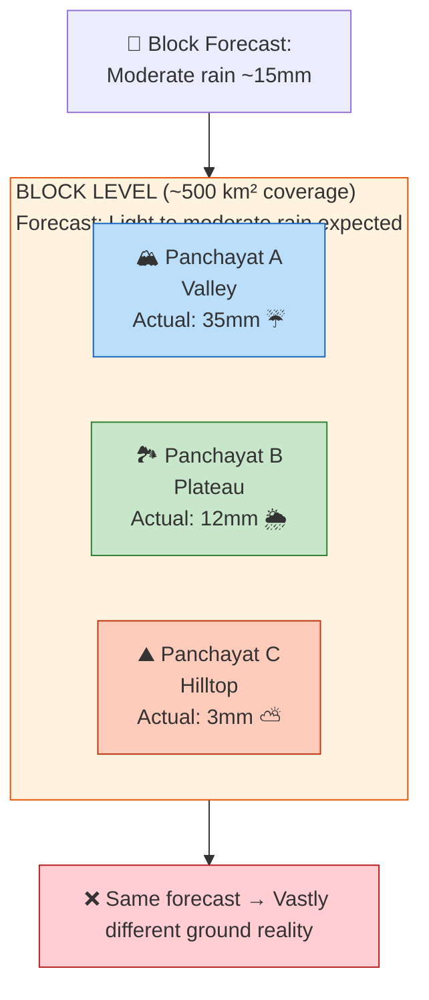
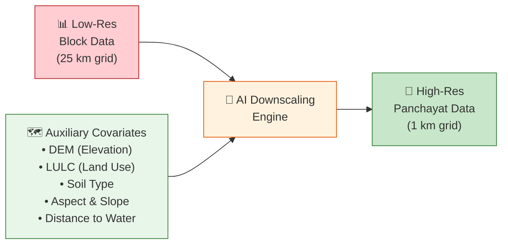
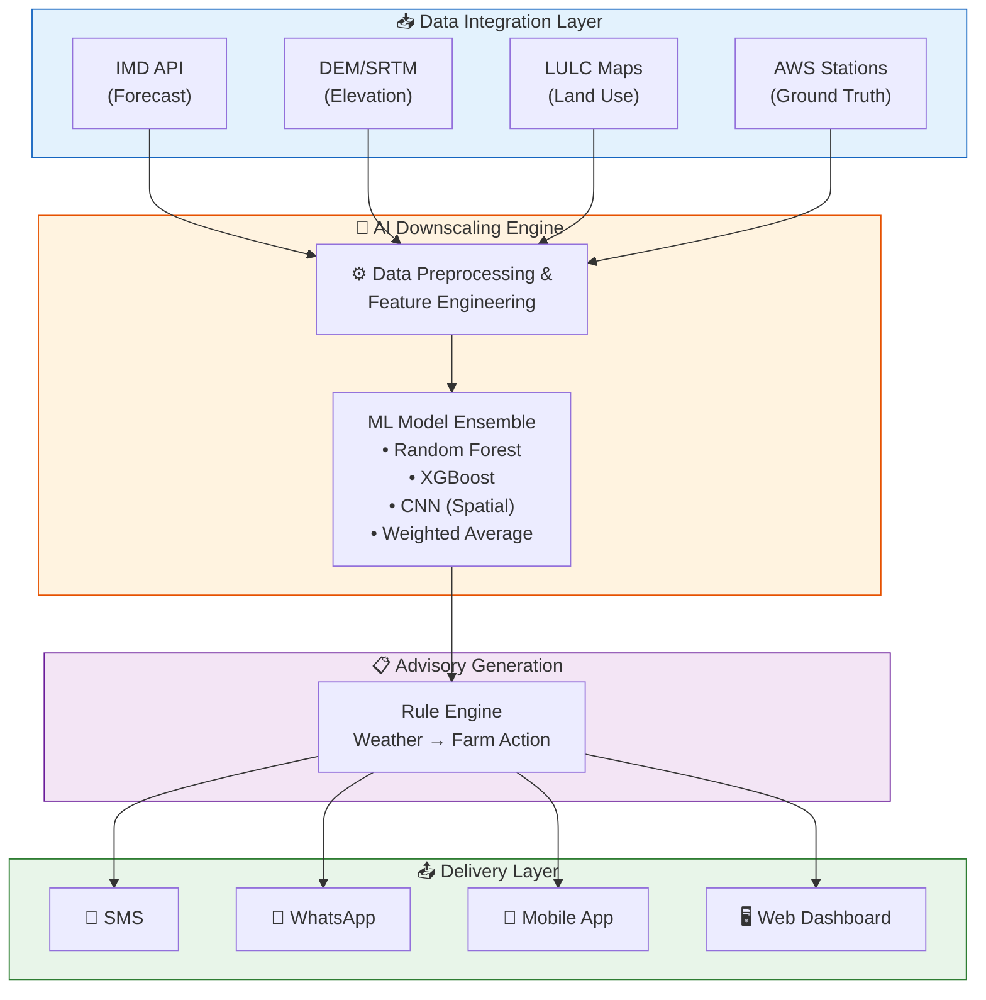

# 📋 Project Report: Agro-Meteorological High-Resolution Downscaling System

> **Downscaling of Weather Forecasts from Block to Panchayat Level for Precision Agriculture**

---

## 1. Project Identity

| Field | Detail |
|-------|--------|
| **Project Title** | Downscaling of Weather Forecasts from Block to Panchayat Level for Precision Agriculture |
| **Organization** | Ministry of Earth Sciences (MoES) / India Meteorological Department (IMD) |
| **Collaborators** | IITM Pune, ICAR, State Agricultural Universities |
| **Category** | Software / AI-ML |
| **Theme** | Agriculture, FoodTech & Rural Development |
| **Project Duration** | 18 Months (3 Phases) |
| **Estimated Budget** | ₹4.5 Crore |
| **Target Beneficiaries** | 250+ Million farming households across India |

---

## 2. Executive Summary

India's agricultural sector employs **42% of the workforce** and contributes **~18% to GDP**, yet it remains critically vulnerable to weather variability. The India Meteorological Department (IMD) currently provides weather forecasts at the **Block level** (administrative unit covering ~500 km²), which is far too coarse for precision farming decisions.

Within a single block, weather can vary dramatically — a hilltop village may receive 40% less rainfall than a valley settlement just 15 km away. This **"resolution gap"** means that generic block-level advisories often fail to match the hyper-local weather reality that farmers experience, leading to:

- **Mistrust** in government weather advisories
- **Crop losses** due to untimely irrigation, sowing, or harvesting
- **Resource wastage** from blanket-applied fertilizers and pesticides

This project proposes an **AI-driven statistical downscaling system** that bridges this resolution gap by transforming block-level forecasts into **Panchayat-level predictions** (covering ~25 km²). Using machine learning models trained on historical weather station data and guided by geographical covariates (elevation, land use, soil type), the system generates hyper-local weather parameters for every Panchayat within a block.

The output is delivered through a **farmer-facing advisory system** (SMS, WhatsApp, mobile app, and web dashboard) that converts raw meteorological data into **actionable agricultural advice** in regional languages.

---

## 3. Problem Definition

### 3.1 The Resolution Gap

### 3.2 Key Issues

| Issue | Description | Impact |
|-------|-------------|--------|
| **Topographic Variation** | A block may contain valleys (200m ASL) and hilltops (1500m ASL). Temperature drops ~6.5°C per 1000m elevation. | One temperature forecast cannot serve both. |
| **Land Use Variation** | Forested areas retain moisture; urban heat islands raise temperature; irrigated fields have different evapotranspiration. | Humidity and rainfall distribution are uneven. |
| **Micro-Climate Effects** | Rain shadows, wind tunnels, and coastal proximity create micro-climates within a block. | Block averages mask critical local variations. |
| **Advisory Mismatch** | When the block forecast says "no rain" but it rains in a village, farmers lose trust. | 60% of farmers report ignoring IMD advisories. |
| **Economic Loss** | Farmers make costly decisions (irrigation pump fuel, pesticide purchases) based on inaccurate data. | ₹1.5 lakh crore annual crop loss from weather events. |

### 3.3 Objective

To build a computational model that **downscales** coarse block-level data into a high-resolution grid, providing each Panchayat with a **tailored weather forecast** based on its unique geographical and environmental characteristics.

**Specific Goals:**
1. Achieve spatial resolution of **1 km × 1 km** grid within each Panchayat
2. Downscale **5 key parameters**: Temperature (Max/Min), Rainfall, Relative Humidity, Wind Speed
3. Achieve prediction accuracy of **RMSE < 2°C** for temperature and **< 5mm** for rainfall
4. Deliver advisories within **30 minutes** of IMD block forecast release
5. Cover **all 2.5 lakh+ Panchayats** in India within 3 years

---

## 4. Proposed Solution & Methodology

### 4.1 The Technical Approach: Statistical Downscaling with ML

The system uses a **Super-Resolution Machine Learning** approach, analogous to how AI upscales low-resolution images to high-resolution. Instead of simple spatial interpolation (which just smooths data), the model uses **Auxiliary Covariates** (geographical "clues") to predict realistic local weather.

### 4.2 How It Works (Simplified)

1. **Input**: IMD releases block forecast → "District: Pune, Block: Mulshi, Tomorrow Max Temp: 32°C, Rainfall: 15mm"
2. **Enrichment**: System overlays geographical data → "Panchayat A is at 800m elevation with forest cover; Panchayat B is at 200m in an open plain"
3. **Prediction**: ML model infers → "Panchayat A: Max Temp 27°C, Rain 22mm | Panchayat B: Max Temp 34°C, Rain 8mm"
4. **Advisory**: System generates → "Panchayat A: Heavy rain expected, postpone spraying. | Panchayat B: Hot and dry, irrigate crops today."

### 4.3 Model Training

The model learns from **historical correlations**:

**Training Data Structure:**

| Block_Temp | Block_Rain | Elevation | LULC | Actual_Temp | Actual_Rain |
|------------|------------|-----------|------|-------------|-------------|
| 32°C | 15mm | 800m | Forest | 27°C | 22mm |
| 32°C | 15mm | 200m | Plains | 34°C | 8mm |
| 28°C | 5mm | 500m | Urban | 30°C | 3mm |

> **The model learns**: *"When block says 32°C and the location is at 800m with forest, the actual temperature is likely ~27°C."*

---

## 5. System Architecture (Summary)

> For detailed architecture, see [Architecture Document](architecture.md)

---

## 6. Technology Stack (Summary)

> For detailed tech stack, see [Tech Stack Document](techstack.md)

| Layer | Technology | Purpose |
|-------|-----------|---------|
| **AI/ML** | Scikit-Learn, XGBoost, TensorFlow | Model training and inference |
| **Geospatial** | GeoPandas, Rasterio, Xarray | Spatial data processing |
| **Backend** | FastAPI, Celery, Redis | API and task queue |
| **Frontend** | React.js, Mapbox GL | Dashboard and visualization |
| **Database** | PostgreSQL + PostGIS | Spatial queries and storage |
| **Infrastructure** | Docker, Kubernetes, AWS/GCP | Deployment and scaling |

---

## 7. Impact & Benefits

> For detailed impact analysis, see [Impact Analysis Document](impact_analysis.md)

### 7.1 Direct Benefits

| Beneficiary | Impact |
|-------------|--------|
| **Farmers** | 20-30% reduction in crop losses due to precise weather-based decisions |
| **Government** | Higher trust in IMD advisories; better policy targeting |
| **Economy** | ₹15,000-25,000 crore potential annual savings from reduced crop loss |
| **Environment** | 15-20% reduction in water and chemical usage through precision farming |

### 7.2 Scale of Impact

- **250+ million** farming households can benefit
- **2.5 lakh+** Panchayats to be covered
- **140 million hectares** of cropland to receive precision advisories
- **15 agro-climatic zones** of India to be modeled

---

## 8. Implementation Roadmap (Summary)

> For detailed roadmap, see [Roadmap Document](roadmap.md)

| Phase | Duration | Key Deliverables |
|-------|----------|------------------|
| **Phase 1: Research & Data** | Months 1-4 | Data pipeline, feature engineering, baseline models |
| **Phase 2: Development** | Months 5-10 | ML model training, API development, dashboard |
| **Phase 3: Validation** | Months 11-14 | Field testing, accuracy validation, farmer feedback |
| **Phase 4: Deployment** | Months 15-18 | Production deployment, scaling, advisory system launch |

---

## 9. Budget Estimate

| Component | Estimated Cost (₹) |
|-----------|-------------------|
| **Hardware & Cloud Infrastructure** | 1,20,00,000 |
| **Software Licenses & APIs** | 30,00,000 |
| **Human Resources (18 months)** | 2,00,00,000 |
| **Data Acquisition** | 40,00,000 |
| **Field Testing & Validation** | 30,00,000 |
| **Training & Capacity Building** | 20,00,000 |
| **Contingency (10%)** | 44,00,000 |
| **Total** | **4,84,00,000** |

---

## 10. Conclusion

By bridging the gap between Block-level forecasting and Panchayat-level reality, this project transforms generic weather data into a **precision tool for rural development**. The use of AI-driven downscaling ensures that no farmer is left behind due to the "coarseness" of traditional meteorological models.

The system is designed to be:
- **Scalable**: From one district to all of India
- **Accurate**: RMSE < 2°C for temperature, < 5mm for rainfall
- **Actionable**: Raw data converted to farming advice in local languages
- **Inclusive**: SMS-based delivery ensures no smartphone is needed

This is not just a weather prediction tool — it is a **decision support system** that empowers India's farmers with the right information at the right time.

---

## 11. References

1. India Meteorological Department. (2024). *Gramin Krishi Mausam Seva (GKMS) Guidelines*.
2. Wilby, R.L. et al. (2004). *Guidelines for use of climate scenarios developed from statistical downscaling methods*. IPCC-TGICA.
3. Maraun, D. (2016). *Bias Correcting Climate Change Simulations - a Critical Review*. Current Climate Change Reports.
4. Ministry of Agriculture & Farmers Welfare. (2023). *Agricultural Statistics at a Glance*.
5. ISRO. (2023). *NRSC Land Use Land Cover Atlas of India*.
6. NASA/USGS. (2023). *SRTM Digital Elevation Model Documentation*.

---

*Document Version: 1.0 | Last Updated: September 2026 | Classification: Internal*
