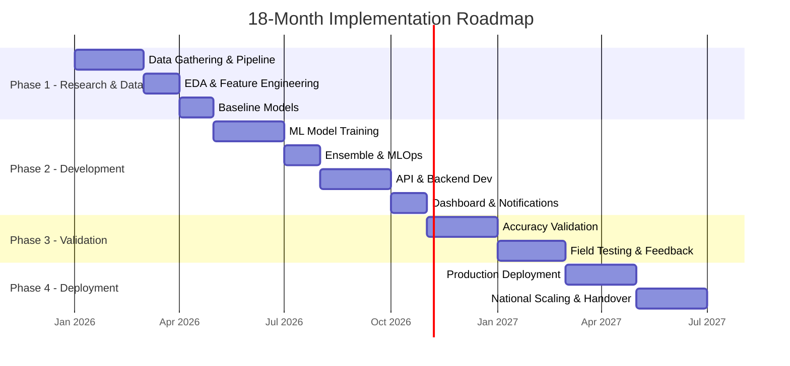

# 🗺️ Implementation Roadmap

> **18-Month Project Timeline with Milestones and Deliverables**

---

## 1. Timeline Overview

---

## 2. Phase 1: Research & Data Collection (Months 1-4)

### Objective
Establish the data foundation, build the ingestion pipeline, and create baseline models.

### Month 1: Project Setup & Data Audit

| Week | Task | Deliverable | Owner |
|------|------|-------------|-------|
| W1 | Project kickoff; team onboarding | Project charter signed | PM |
| W1-2 | MoU with IMD for data access | Signed MoU; API credentials | PM + Legal |
| W2 | Set up development environment | Docker Compose running locally | DevOps |
| W3 | Audit all data sources; verify access | Data audit report | Data Engineer |
| W4 | Download static datasets (SRTM, LULC, Soil) | Raw data in S3 | Data Engineer |

**Milestone M1**: ✅ All data sources identified and access secured

### Month 2: Data Pipeline & Preprocessing

| Week | Task | Deliverable | Owner |
|------|------|-------------|-------|
| W5-6 | Build SRTM DEM processing pipeline | Panchayat elevation features table | GIS Engineer |
| W6-7 | Build LULC processing pipeline | Panchayat land use features table | GIS Engineer |
| W7 | Build soil data processing pipeline | Panchayat soil features table | Data Engineer |
| W8 | Build IMD forecast ingestion pipeline | Automated forecast ingestion | Backend Dev |
| W8 | Build AWS station data ingestion | Historical AWS data in DB | Data Engineer |

**Milestone M2**: ✅ All data ingestion pipelines operational

### Month 3: EDA & Feature Engineering

| Week | Task | Deliverable | Owner |
|------|------|-------------|-------|
| W9-10 | Exploratory Data Analysis | EDA report with key insights | Data Scientist |
| W10 | Correlation analysis: elevation vs. temperature | Feature importance report | Data Scientist |
| W11 | Feature engineering: derive 35 features | Feature matrix (training set) | ML Engineer |
| W12 | Data quality report; handle missing data | Cleaned training dataset (Parquet) | Data Engineer |

**Milestone M3**: ✅ Training dataset assembled and validated

### Month 4: Baseline Models

| Week | Task | Deliverable | Owner |
|------|------|-------------|-------|
| W13-14 | Train baseline models (Linear Regression, simple RF) | Baseline RMSE scores | ML Engineer |
| W15 | Implement spatial cross-validation | Spatial CV framework | ML Engineer |
| W16 | Baseline evaluation report | Phase 1 completion report | Data Scientist |

**Milestone M4**: ✅ Baseline models trained; Phase 1 complete

---

## 3. Phase 2: Development (Months 5-10)

### Objective
Build the ML models, API, dashboard, and advisory engine to production quality.

### Month 5-6: ML Model Development

| Week | Task | Deliverable | Owner |
|------|------|-------------|-------|
| W17-18 | Train Random Forest models (5 parameters) | RF models with evaluation | ML Engineer |
| W19-20 | Train XGBoost models (5 parameters) | XGBoost models with evaluation | ML Engineer |
| W21-22 | Hyperparameter tuning with Optuna | Optimized model configs | ML Engineer |
| W23-24 | Build CNN U-Net for spatial downscaling | Trained CNN model | ML Engineer |

**Milestone M5**: ✅ All base models trained and evaluated

### Month 7: Ensemble & MLOps

| Week | Task | Deliverable | Owner |
|------|------|-------------|-------|
| W25-26 | Build ensemble (stacking with Ridge) | Ensemble model with improved RMSE | ML Engineer |
| W27 | Set up MLflow for experiment tracking | MLflow server running | MLOps |
| W28 | Model versioning and registry | Champion models registered | MLOps |
| W28 | Post-processing pipeline (bias correction) | Post-processing module | ML Engineer |

**Milestone M6**: ✅ Ensemble model achieves target RMSE

### Month 8-9: API & Backend Development

| Week | Task | Deliverable | Owner |
|------|------|-------------|-------|
| W29-30 | Build FastAPI application skeleton | API with health check | Backend Dev |
| W31-32 | Implement forecast endpoints | GET /forecast working | Backend Dev |
| W33 | Implement advisory endpoints | GET /advisory working | Backend Dev |
| W34 | Build advisory rule engine | 50+ advisory rules | Agri Expert + Dev |
| W35 | Multi-lingual NLG module | Advisories in 5 languages | NLP Engineer |
| W36 | Authentication, rate limiting | Secured API | Backend Dev |

**Milestone M7**: ✅ API fully functional with all endpoints

### Month 10: Dashboard & Notification System

| Week | Task | Deliverable | Owner |
|------|------|-------------|-------|
| W37-38 | Build React dashboard with Mapbox map | Interactive map dashboard | Frontend Dev |
| W39 | SMS notification pipeline | Bulk SMS delivery working | Backend Dev |
| W40 | WhatsApp notification pipeline | WhatsApp advisory delivery | Backend Dev |
| W40 | End-to-end integration testing | All systems connected | QA |

**Milestone M8**: ✅ Complete system integrated; Phase 2 complete

---

## 4. Phase 3: Validation & Testing (Months 11-14)

### Objective
Validate model accuracy against ground truth, conduct field testing, and incorporate farmer feedback.

### Month 11-12: Accuracy Validation

| Week | Task | Deliverable | Owner |
|------|------|-------------|-------|
| W41-42 | Compare predictions vs. AWS ground truth | Accuracy validation report | Data Scientist |
| W43-44 | Regional accuracy analysis (per agro-zone) | Regional accuracy matrix | ML Engineer |
| W45-46 | Install 20 temporary validation stations | Ground truth from new stations | Field Team |
| W47-48 | Bias analysis and correction per region | Region-specific bias corrections | ML Engineer |

**Milestone M9**: ✅ Model accuracy validated; RMSE targets met

### Month 13-14: Field Testing & User Feedback

| Week | Task | Deliverable | Owner |
|------|------|-------------|-------|
| W49-50 | Pilot with 100 farmers in 1 district | Farmer feedback report | Field Team |
| W51-52 | Advisory review by Krishi Vigyan Kendras | Expert validation of advisories | Agri Expert |
| W53 | Usability testing of dashboard | UX improvement backlog | UX Designer |
| W54 | Incorporate feedback; retrain models | Updated models and rules | ML Engineer |
| W55-56 | Security audit and penetration testing | Security clearance report | Security |

**Milestone M10**: ✅ Field tested and validated; Phase 3 complete

---

## 5. Phase 4: Deployment & Scaling (Months 15-18)

### Objective
Deploy to production, scale to multiple states, and launch the advisory system.

### Month 15-16: Production Deployment

| Week | Task | Deliverable | Owner |
|------|------|-------------|-------|
| W57-58 | Set up Kubernetes production cluster | Production infrastructure ready | DevOps |
| W59-60 | Deploy all services to production | System running in production | DevOps |
| W61 | Set up monitoring (Prometheus, Grafana) | Monitoring dashboards | DevOps |
| W62 | Load testing (1 lakh Panchayats) | Performance benchmark report | QA |
| W63-64 | Scale to 5 states (Maharashtra, UP, MP, Karnataka, TN) | 5-state coverage live | Team |

**Milestone M11**: ✅ Production system live for 5 states

### Month 17-18: National Scaling & Handover

| Week | Task | Deliverable | Owner |
|------|------|-------------|-------|
| W65-68 | Extend to all 28 states + 8 UTs | National coverage | Team |
| W69-70 | Operator training for IMD staff | Training manual + workshops | PM |
| W71 | Documentation finalization | Complete technical docs | All |
| W72 | Project handover to IMD operations | Handover document signed | PM |

**Milestone M12**: ✅ National deployment complete; Project handed over

---

## 6. Critical Path

**Critical Path Items** (delays here delay the entire project):
1. IMD MoU signing (blocks all data access)
2. DEM/LULC processing (blocks feature engineering)
3. Model training completion (blocks API development)
4. Security audit (blocks production deployment)

---

## 7. Team Structure

| Role | Count | Phase 1 | Phase 2 | Phase 3 | Phase 4 |
|------|-------|---------|---------|---------|---------|
| Project Manager | 1 | ● | ● | ● | ● |
| Data Scientist | 2 | ● | ● | ● | ○ |
| ML Engineer | 2 | ○ | ● | ● | ○ |
| Backend Developer | 2 | ○ | ● | ○ | ● |
| Frontend Developer | 1 | ○ | ● | ○ | ○ |
| GIS / Remote Sensing Expert | 1 | ● | ○ | ○ | ○ |
| DevOps Engineer | 1 | ○ | ○ | ○ | ● |
| Agriculture Domain Expert | 1 | ● | ● | ● | ○ |
| QA Engineer | 1 | ○ | ○ | ● | ● |
| Field Coordinator | 1 | ○ | ○ | ● | ● |
| **Total** | **13** | | | | |

● = Full-time on project | ○ = Part-time / Available

---

## 8. Risk Factors & Contingencies

| Risk | Probability | Impact | Mitigation |
|------|-------------|--------|------------|
| IMD MoU delayed | Medium | Critical | Start with open data (ERA5) while MoU is processed |
| Insufficient AWS stations in pilot area | Medium | High | Use satellite-derived rainfall (GPM) as supplement |
| Model accuracy below target | Low | High | Try advanced models (LightGBM, Transformer); add more features |
| Cloud infrastructure costs exceed budget | Medium | Medium | Use NIC Cloud (government); optimize instance types |
| Farmer adoption low in pilot | Medium | Medium | Partner with KVKs and Gram Panchayats for awareness |

---

*Document Version: 1.0 | Last Updated: September 2026*
