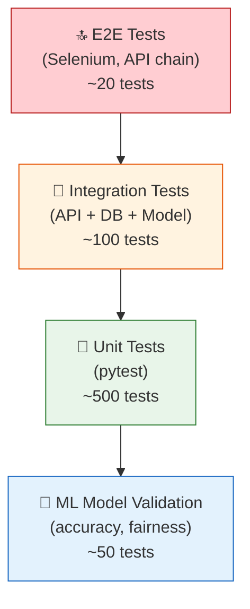

# 🧪 Testing Strategy

> **Comprehensive Testing Approach for Quality Assurance**

---

## 1. Testing Overview



---

## 2. Unit Testing

### 2.1 Coverage Targets

| Module | Target Coverage | Key Tests |
|--------|----------------|-----------|
| `ingestion/` | 90% | Parser correctness, API client mocking |
| `preprocessing/` | 95% | Feature computation, edge cases |
| `models/` | 85% | Prediction shape, feature importance |
| `advisory/` | 95% | Rule evaluation, NLG output |
| `api/` | 90% | Endpoint responses, validation |
| `utils/` | 95% | Geo calculations, validators |

### 2.2 Example Unit Tests

```python
# tests/unit/test_feature_engineering.py

class TestFeatureEngineering:
    def test_temperature_lapse_rate(self):
        """Elevation anomaly of +1000m should predict ~6.5°C cooler."""
        fe = FeatureEngineer()
        features = fe.create_features(
            forecast=BlockForecast(temp_max=35.0, ...),
            panchayat=Panchayat(elevation_mean=1500, block_mean_elev=500)
        )
        assert features.temp_lapse_estimate == pytest.approx(-6.5, abs=0.1)

    def test_orographic_factor_upslope(self):
        """Wind hitting upslope should enhance rainfall."""
        fe = FeatureEngineer()
        features = fe.create_features(
            forecast=BlockForecast(wind_direction=270, ...),  # West wind
            panchayat=Panchayat(aspect_dominant=270, slope_mean=15)  # West-facing
        )
        assert features.rain_orographic_factor > 0

    def test_orographic_factor_downslope(self):
        """Wind parallel to slope should not enhance rainfall."""
        fe = FeatureEngineer()
        features = fe.create_features(
            forecast=BlockForecast(wind_direction=0, ...),    # North wind
            panchayat=Panchayat(aspect_dominant=90, slope_mean=15)  # East-facing
        )
        assert features.rain_orographic_factor == pytest.approx(0, abs=0.01)

    def test_circular_encoding_aspect(self):
        """Aspect 0° (North) should have sin=0, cos=1."""
        fe = FeatureEngineer()
        features = fe.create_features(
            forecast=BlockForecast(...),
            panchayat=Panchayat(aspect_dominant=0)
        )
        assert features.aspect_sin == pytest.approx(0, abs=0.01)
        assert features.aspect_cos == pytest.approx(1, abs=0.01)


# tests/unit/test_rule_engine.py

class TestRuleEngine:
    def test_heavy_rain_alert(self):
        """Rain > 30mm during flowering should trigger orange alert."""
        engine = RuleEngine()
        advisories = engine.evaluate(
            forecast=PanchayatForecast(rainfall=45),
            crop="rice",
            context=FarmContext(crop_stage=CropStage.FLOWERING)
        )
        assert any(a.severity == Severity.ORANGE for a in advisories)
        assert any("rain" in a.advisory_text.lower() for a in advisories)

    def test_no_alert_normal_conditions(self):
        """Normal weather should produce green (informational) advisories only."""
        engine = RuleEngine()
        advisories = engine.evaluate(
            forecast=PanchayatForecast(temp_max=30, rainfall=5, humidity=60),
            crop="rice",
            context=FarmContext(crop_stage=CropStage.VEGETATIVE)
        )
        assert all(a.severity in [Severity.GREEN] for a in advisories)

    def test_frost_alert(self):
        """Temp < 4°C should trigger red alert."""
        engine = RuleEngine()
        advisories = engine.evaluate(
            forecast=PanchayatForecast(temp_min=2),
            crop="wheat",
            context=FarmContext(crop_stage=CropStage.FLOWERING)
        )
        assert any(a.severity == Severity.RED for a in advisories)
        assert any("frost" in a.advisory_text.lower() for a in advisories)
```

---

## 3. Integration Testing

### 3.1 API Integration Tests

```python
# tests/integration/test_api.py
from fastapi.testclient import TestClient

class TestForecastAPI:
    def test_get_forecast_valid_panchayat(self, client: TestClient):
        response = client.get(
            "/api/v1/forecast/MH_PUNE_MULSHI_TAMHINI",
            headers={"Authorization": "Bearer test_token"}
        )
        assert response.status_code == 200
        data = response.json()["data"]
        assert data["panchayat"]["id"] == "MH_PUNE_MULSHI_TAMHINI"
        assert len(data["forecasts"]) == 3  # default 3 days
        # Check all required fields present
        forecast = data["forecasts"][0]
        assert "temp_max" in forecast["parameters"]
        assert "rainfall" in forecast["parameters"]
        assert 0 <= forecast["confidence"] <= 1

    def test_get_forecast_invalid_panchayat(self, client: TestClient):
        response = client.get("/api/v1/forecast/INVALID_ID")
        assert response.status_code == 404

    def test_get_forecast_with_uncertainty(self, client: TestClient):
        response = client.get(
            "/api/v1/forecast/MH_PUNE_MULSHI_TAMHINI?include_uncertainty=true"
        )
        data = response.json()["data"]
        forecast = data["forecasts"][0]
        assert "uncertainty" in forecast
        assert forecast["uncertainty"]["temp_max"]["lower"] < forecast["parameters"]["temp_max"]["value"]
        assert forecast["uncertainty"]["temp_max"]["upper"] > forecast["parameters"]["temp_max"]["value"]
```

### 3.2 Database Integration Tests

```python
# tests/integration/test_db.py

class TestDatabaseIntegration:
    def test_spatial_query_panchayats_in_block(self, db_session):
        """PostGIS spatial query should return correct Panchayats."""
        panchayats = db_session.query(Panchayat).filter(
            Panchayat.block_id == "MH_PUNE_MULSHI"
        ).all()
        assert len(panchayats) > 0
        for p in panchayats:
            assert p.geometry is not None
            assert p.elevation_mean is not None

    def test_forecast_storage_and_retrieval(self, db_session):
        """Forecast should be stored and retrieved correctly."""
        forecast = PanchayatForecast(
            panchayat_id="TEST_001",
            forecast_date=date(2026, 9, 26),
            temp_max=27.3,
            rainfall=22.5,
        )
        db_session.add(forecast)
        db_session.commit()

        retrieved = db_session.query(PanchayatForecast).filter_by(
            panchayat_id="TEST_001"
        ).first()
        assert retrieved.temp_max == 27.3
        assert retrieved.rainfall == 22.5
```

---

## 4. ML Model Validation Tests

### 4.1 Accuracy Tests

```python
# tests/ml/test_model_accuracy.py

class TestModelAccuracy:
    def test_temperature_rmse_below_threshold(self, trained_model, test_data):
        """Temperature RMSE must be < 2°C on test set."""
        X_test, y_test = test_data['temp_max']
        y_pred = trained_model.predict(X_test)
        rmse = np.sqrt(mean_squared_error(y_test, y_pred))
        assert rmse < 2.0, f"Temperature RMSE {rmse:.2f}°C exceeds threshold of 2.0°C"

    def test_rainfall_rmse_below_threshold(self, trained_model, test_data):
        """Rainfall RMSE must be < 5mm on test set."""
        X_test, y_test = test_data['rainfall']
        y_pred = trained_model.predict(X_test)
        rmse = np.sqrt(mean_squared_error(y_test, y_pred))
        assert rmse < 5.0, f"Rainfall RMSE {rmse:.2f}mm exceeds threshold of 5.0mm"

    def test_skill_score_positive(self, trained_model, block_baseline, test_data):
        """Downscaled forecast must be better than raw block forecast."""
        X_test, y_test = test_data['temp_max']
        y_pred = trained_model.predict(X_test)

        rmse_model = np.sqrt(mean_squared_error(y_test, y_pred))
        rmse_block = np.sqrt(mean_squared_error(y_test, block_baseline))

        skill_score = 1 - (rmse_model / rmse_block)
        assert skill_score > 0.3, f"Skill score {skill_score:.2f} too low (must be > 0.3)"

    def test_predictions_physically_consistent(self, trained_model, test_data):
        """Predictions must satisfy physical constraints."""
        X_test, _ = test_data['temp_max']
        y_pred = trained_model.predict(X_test)

        # Temperature must be in realistic range
        assert np.all(y_pred > -15), "Predicted temperature below -15°C"
        assert np.all(y_pred < 55), "Predicted temperature above 55°C"

    def test_no_systematic_bias(self, trained_model, test_data):
        """Model should not have systematic bias > 0.5°C."""
        X_test, y_test = test_data['temp_max']
        y_pred = trained_model.predict(X_test)
        bias = np.mean(y_pred - y_test)
        assert abs(bias) < 0.5, f"Systematic bias of {bias:.2f}°C detected"
```

### 4.2 Fairness & Regional Tests

```python
class TestModelFairness:
    def test_equal_accuracy_across_regions(self, trained_model, test_data_by_region):
        """RMSE should not vary by more than 50% across regions."""
        rmse_by_region = {}
        for region, (X, y) in test_data_by_region.items():
            y_pred = trained_model.predict(X)
            rmse_by_region[region] = np.sqrt(mean_squared_error(y, y_pred))

        max_rmse = max(rmse_by_region.values())
        min_rmse = min(rmse_by_region.values())
        ratio = max_rmse / min_rmse

        assert ratio < 1.5, (
            f"Regional accuracy disparity too high: "
            f"best={min_rmse:.2f}, worst={max_rmse:.2f}, ratio={ratio:.2f}"
        )

    def test_monsoon_vs_non_monsoon_accuracy(self, trained_model, test_data_by_season):
        """Model should perform reasonably in both monsoon and non-monsoon."""
        rmse_monsoon = compute_rmse(trained_model, test_data_by_season['monsoon'])
        rmse_non_monsoon = compute_rmse(trained_model, test_data_by_season['non_monsoon'])

        # Monsoon is harder; allow 30% worse
        assert rmse_monsoon < rmse_non_monsoon * 1.3
```

---

## 5. End-to-End (E2E) Tests

```python
# tests/e2e/test_full_pipeline.py

class TestFullPipeline:
    def test_forecast_generation_pipeline(self):
        """
        E2E: IMD forecast → Ingestion → Feature Engineering
        → ML Prediction → Advisory → Storage
        """
        # Step 1: Simulate IMD forecast arrival
        mock_grib = create_mock_grib_file(block="MH_PUNE_MULSHI")

        # Step 2: Run ingestion pipeline
        ingestion_result = ingest_forecast(mock_grib)
        assert ingestion_result.status == "success"

        # Step 3: Run downscaling for all Panchayats in block
        downscale_result = run_downscaling("MH_PUNE_MULSHI")
        assert len(downscale_result.panchayat_forecasts) >= 10

        # Step 4: Verify forecasts stored in DB
        stored = db.query(PanchayatForecast).filter_by(
            date=date.today() + timedelta(days=1)
        ).all()
        assert len(stored) >= 10

        # Step 5: Verify advisories generated
        advisories = db.query(Advisory).filter_by(
            date=date.today() + timedelta(days=1)
        ).all()
        assert len(advisories) >= 5

    def test_advisory_sms_delivery(self):
        """E2E: Advisory → SMS formatting → Gateway delivery."""
        advisory = Advisory(
            panchayat_id="MH_PUNE_MULSHI_TAMHINI",
            message="Heavy rain expected. Postpone harvesting.",
            language="hi"
        )

        result = sms_service.send(
            advisory=advisory,
            phone_numbers=["+919876543210"],
            sandbox=True
        )

        assert result.status == "delivered"
        assert result.message_count == 1
```

---

## 6. Performance Testing

| Test | Tool | Target | Scenario |
|------|------|--------|----------|
| **API Load Test** | Locust | < 100ms p99 at 1000 RPS | Concurrent forecast queries |
| **ML Inference Latency** | pytest-benchmark | < 50ms per Panchayat | Single model prediction |
| **Batch Processing** | Custom script | < 30 min for all India | Full forecast cycle |
| **Database Query** | pgbench | < 20ms spatial query | PostGIS bounding box |
| **SMS Throughput** | MSG91 sandbox | 1 lakh/min delivery | Bulk SMS send |

---

## 7. Test Execution Plan

```bash
# Run all unit tests
pytest tests/unit/ -v --cov=src --cov-report=html

# Run integration tests (requires Docker Compose)
docker-compose -f docker/docker-compose.test.yml up -d
pytest tests/integration/ -v

# Run ML model validation
pytest tests/ml/ -v --model-path=models/champion/

# Run E2E tests
pytest tests/e2e/ -v --slow

# Run performance tests
locust -f tests/performance/locustfile.py --host=http://localhost:8000

# Full test suite (CI/CD)
pytest tests/ -v --cov=src --cov-fail-under=85 --junitxml=report.xml
```

---

*Document Version: 1.0 | Last Updated: September 2026*
